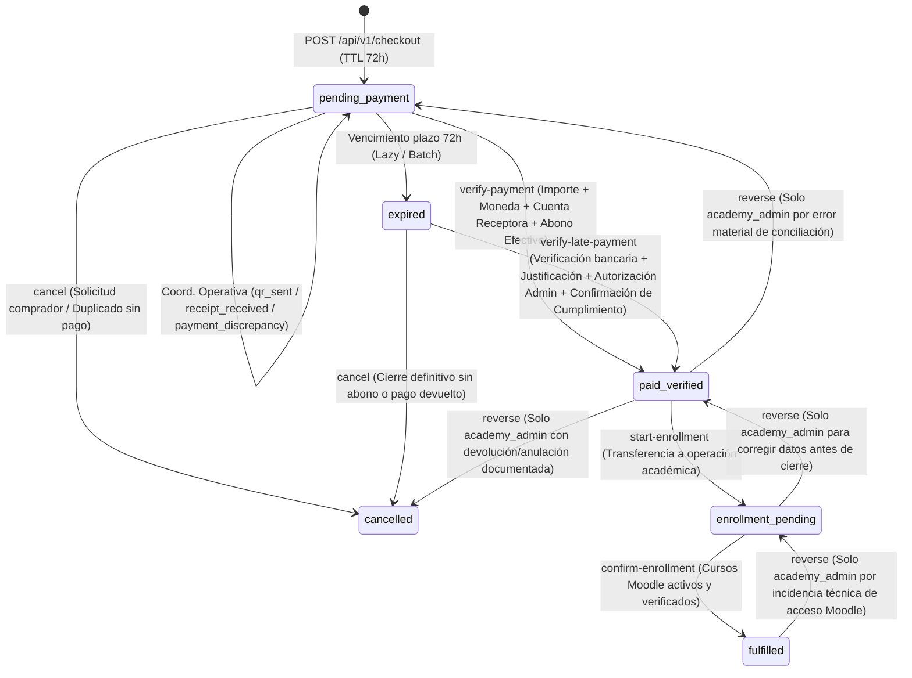
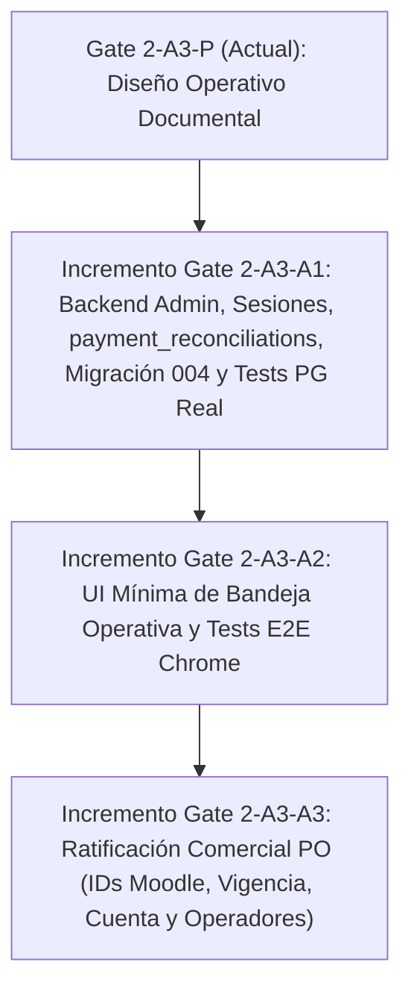

# NOVAFORGE — Gate 2-A3-P: Diseño Operativo de Operación Comercial Asistida

- **Proyecto:** NOVARUM Commerce Engine
- **Cliente MVP:** Dr. Pedro Sevilla — Academia Mujer Sana (`dr-sevilla`)
- **Gate Anterior:** Gate 2-A2 — PASS Definitivo
- **Rama Base Aprobada:** `feature/gate2-a2-checkout-ui` (`7e7da12337811f8e8d7f3ac5008e6d82bdfcce27`)
- **Rama Documental:** `docs/gate2-a3-p-operational-design`
- **Alcance de esta Etapa:** Exclusivamente diseño operativo, modelo de seguridad, máquina de estados y contratos administrativos. **Cero modificaciones a código de aplicación.**

> [!IMPORTANT]
> **Principio Rector de Arquitectura:** Implementar el circuito mínimo, seguro y auditable: **pedido (`pending_payment`) → QR manual → abono bancario verificado (`paid_verified`) → matrícula Moodle (`enrollment_pending` → `fulfilled`)**, sin desarrollar un CRM generalista, sin construir un sistema complejo de administración de usuarios y sin integrar pasarelas bancarias automáticas.

---

## 1. Contrato Funcional de Operación Asistida

### 1.1 Separación de Responsabilidades y Frontera de Confianza
El flujo comercial de la Academia Mujer Sana (`dr-sevilla`) divide la operación en cuatro dominios con fronteras de autoridad estrictas:

```mermaid
flowchart LR
    subgraph Public["1. Dominio Público (Gate 2-A2)"]
        A["Compradora selecciona SKU y envía Checkout"] --> B["Orden creada en pending_payment"]
    end
    subgraph Coord["2. Coordinación Humana de Pago QR"]
        B --> C["Operador genera QR en banca oficial y lo envía manualmente"]
        C --> D["Evento auditable: qr_sent / receipt_received (sigue en pending_payment)"]
    end
    subgraph Bank["3. Conciliación Financiera (Autoridad Bancaria)"]
        D --> E["Verificador comprueba importe, moneda, cuenta receptora y abono efectivo"]
        E --> F["Transición atómica a paid_verified"]
    end
    subgraph Moodle["4. Operación Académica (Moodle)"]
        F --> G["Inicio de alta académica: enrollment_pending"]
        G --> H["Alta manual en Moodle + acceso verificado: fulfilled"]
    end
```



### 1.2 Invariantes Contractuales Obligatorios
1. **Autoridad exclusiva del backend administrativo:** Ningún endpoint público ni acción originada desde el navegador del comprador tiene autoridad para transicionar un pedido hacia `paid_verified`, `enrollment_pending` o `fulfilled`.
2. **El comprobante del comprador NO es pago verificado:** La recepción de una captura o PDF enviado por WhatsApp/correo se registra únicamente como evento informativo (`receipt_received` dentro de `order_events`), manteniendo `orders.status = 'pending_payment'`.
3. **Conciliación bancaria multidimensional e identidad inmutable del abono:** Para autorizar `paid_verified`, el operador autorizado debe comprobar en la banca oficial:
   - **Importe exacto** (`verified_amount_minor === orders.total_amount_minor`),
   - **Moneda** (`BOB`),
   - **Cuenta receptora oficial ratificada** (`recipient_account_id` / confirmación explícita de cuenta destino), y
   - **Transacción bancaria efectiva** (abono real acreditado en extracto).
   - **Distinción entre identidad transaccional única y referencia bancaria externa:** Cada verificación bancaria genera un registro único de conciliación (`reconciliation_id` UUID en `payment_reconciliations`) que preserva la identidad y evidencia del abono **en todos los estados de conciliación (`applied`, `reversed_mistaken_match` y `refunded_or_annulled`) e independientemente de `orders.status`**. La referencia bancaria externa (`bank_reference`) se utiliza para detectar y bloquear duplicados cuando está disponible, sin asumir que siempre estará presente o será inequívoca (los casos ambiguos requieren resolución humana explícita) y **sin liberar jamás la referencia ni permitir que `verify-payment` ordinario la reutilice tras una cancelación, anulación o reversión (`reversed_mistaken_match`)**. Cualquier reimputación excepcional de un abono revertido por error material se ejecuta exclusivamente por `academy_admin` de forma transaccional sobre el mismo `reconciliation_id` original (`reallocate-reconciliation`), sin duplicar la identidad del abono.
4. **Prohibición de matrícula sin pago verificado:** El sistema impide técnica y transaccionalmente iniciar (`enrollment_pending`) o confirmar (`fulfilled`) una matrícula si el pedido no ha pasado previamente por `paid_verified`.
5. **Cierre condicionado a entrega efectiva (Pack = 4 matrículas verificadas):** El estado `fulfilled` solo se registra después de que el operador académico ha habilitado el curso individual —o las **cuatro matrículas verificadas individualmente** en el caso del paquete `mujer-informada-4`— en Moodle y confirmado que la estudiante dispone de acceso activo. Los identificadores de curso Moodle del mapa SKU y el parámetro de vigencia de 180 días tienen carácter **provisional** hasta su ratificación comercial previa a la activación.
6. **Aislamiento multi-academia estricto:** Todas las operaciones administrativas resuelven `academy_id = 'dr-sevilla'` desde la configuración/sesión autenticada del servidor y utilizan las claves foráneas compuestas `(academy_id, order_id)` establecidas en PostgreSQL ([001_initial_schema.sql](file:///Users/carlosloayza/.gemini/antigravity/scratch/dr-pedro-sevilla/backend/migrations/001_initial_schema.sql#L75-L119)).
7. **Exclusión de alcance (Anti-Bloat):**
   - No se desarrolla un CRM generalista (sin embudos comerciales, etiquetas libres, historial de chats ni campañas de marketing).
   - No se construye un módulo de administración/ABM de usuarios ni flujos de auto-registro de operadores.
   - No se integran APIs bancarias ni generación automática de códigos QR.
   - No se automatiza el aprovisionamiento vía API hacia Moodle en este gate.

---

## 2. Matriz de Roles, Permisos y Acciones (RBAC Mínimo)

### 2.1 Modelo RBAC Mínimo, Autenticación, Autorización y Revocación de Sesiones
- **Bootstrap nominal sin CRUD empresarial de usuarios:** Los operadores autorizados de `dr-sevilla` se aprovisionan de forma determinista mediante semilla/configuración controlada en PostgreSQL (tabla `admin_operators` con `operator_id` nominal, `academy_id = 'dr-sevilla'`, `role` en `{'academic_operator', 'finance_verifier', 'academy_admin'}`, `password_hash`, `is_active` y `session_version`), sin pantallas de CRUD de usuarios, sin auto-registro ni flujos complejos de gestión de cuentas.
- **Protección de secretos y credenciales:**
  - Las contraseñas de operadores nunca se almacenan ni transitan en texto plano en base de datos; se persisten exclusivamente como hashes con sal (`scrypt` / `Argon2id`) verificados en tiempo constante (`crypto.timingSafeEqual`).
  - El secreto de firma/derivación de sesión (`ADMIN_SESSION_SECRET`, mínimo 32 bytes de alta entropía) se inyecta exclusivamente por variable de entorno de servidor y está sujeto a las reglas de sanitización total de logs de Gate 2-A1.
- **Mecanismo mínimo de sesión, expiración y revocación inmediata:**
  - **Inicio de sesión (`POST /api/v1/admin/session/login`):** Autentica `operator_id` y contraseña contra `admin_operators` (`is_active = true`) y emite una sesión respaldada en servidor (tabla `admin_sessions` con `session_id` UUID/token opaco con hash en BD, `operator_id`, `academy_id`, `role`, `csrf_token`, `created_at`, `expires_at`, `revoked_at`, `revoke_reason`) entregada mediante cookie `HttpOnly; Secure; SameSite=Strict; Path=/api/v1/admin` (o token opaco de sesión en clientes de prueba autorizados) junto con un `csrf_token` asociado a la sesión.
  - **Expiración corta:** Toda sesión administrativa tiene una vigencia máxima estricta (`expires_at = created_at + 8 hours`). Vencido dicho plazo, el servidor rechaza automáticamente cualquier solicitud con `401 Unauthorized`.
  - **Revocación inmediata (por cierre de sesión o emergencia administrativa):**
    1. *Logout explícito (`POST /api/v1/admin/session/logout`):* Marca `revoked_at = NOW()` y `revoke_reason = 'operator_logout'` en `admin_sessions`, limpiando la cookie de sesión.
    2. *Revocación forzosa o desactivación de operador:* Marcar `revoked_at = NOW()` en `admin_sessions`, incrementar `admin_operators.session_version` o establecer `admin_operators.is_active = false` invalida **de forma inmediata en la siguiente petición** todas las sesiones activas de ese operador sin esperar a que expire la cookie/token.
- **Autorización server-side por acción y protección contra falsificación/suplantación:**
  - En cada request a `/api/v1/admin/*`, el middleware valida en servidor que la sesión exista, no esté vencida (`expires_at > NOW()`), no esté revocada (`revoked_at IS NULL`) y pertenezca a un operador activo (`is_active = true`) de `academy_id = 'dr-sevilla'` (`401 Unauthorized` en caso contrario).
  - A continuación, el servidor verifica explícitamente que el `role` de la sesión esté autorizado para la acción/endpoint invocado según la Matriz 2.3 (`403 Forbidden` si el rol no posee permiso).
  - **Protección contra falsificación (CSRF / Origin):** Todos los endpoints mutantes (`POST /api/v1/admin/*`) exigen coincidencia estricta del encabezado `X-CSRF-Token` con el `csrf_token` de la sesión activa y validación de `Origin` permitido, además de `SameSite=Strict`.
  - **Protección contra suplantación de identidad (Anti-Spoofing):** El backend resuelve `operator_id`, `operator_role` y `academy_id` **exclusivamente** desde la sesión autenticada en servidor. Cualquier intento de enviar o sobreescribir `operator_id`, `operator_role` o `academy_id` en el body, query string o encabezados es rechazado/ignorado y jamás puede alterar la autoría registrada en `order_events` ni en `payment_reconciliations`.
  - **Cero autorizaciones financieras implícitas:** Ninguna acción de coordinación ni de matrícula otorga ni presume permisos financieros; ni el frontend, ni el conocimiento de `order_number`, `order.id` u `opaque_token` conceden autoridad administrativa.

### 2.2 Definición de los Tres Roles Operativos
1. **`academic_operator` (Operador Académico):** Consulta la bandeja de pedidos, genera/envía manualmente el QR oficial, registra eventos de coordinación (`qr_sent`, `receipt_received`, `payment_discrepancy`) y ejecuta el flujo de matrícula en Moodle (`paid_verified → enrollment_pending → fulfilled`). **Nunca** puede verificar pagos ni autorizar pagos tardíos.
2. **`finance_verifier` (Verificador Bancario):** Consulta la bandeja de pedidos y autoriza la verificación de abonos ordinarios en vigencia (`pending_payment → paid_verified`) tras comprobar importe, moneda, cuenta receptora y transacción efectiva en banco. **No** puede ejecutar matrículas en Moodle ni reactivar por sí solo pedidos expirados sin autorización administrativa.
3. **`academy_admin` (Administrador Titular / Dirección Operativa):** Rol de autoridad administrativa que, además de poder ejecutar verificaciones y matrículas debidamente identificadas con su `operator_id`, es el **único** facultado para:
   - Autorizar la reactivación y conciliación de un **pago tardío** (`expired → paid_verified`) previa verificación bancaria, justificación, autorización administrativa y confirmación de viabilidad de cumplimiento;
   - Resolver casos de **conciliación bancaria ambigua** o sin referencia estándar; y
   - Ejecutar **reversiones auditables** (`reverse`) ante errores materiales, sin borrar evidencia histórica.

### 2.3 Matriz de Permisos por Acción

| Acción Operativa | Endpoint Administrativo | `public` (Comprador) | `academic_operator` | `finance_verifier` | `academy_admin` |
| :--- | :--- | :---: | :---: | :---: | :---: |
| Crear pedido (`pending_payment`) | `POST /api/v1/checkout` | **SÍ** | — | — | — |
| Consultar estado público sin PII | `GET /api/v1/orders/:opaque_token/status` | **SÍ** | — | — | — |
| Iniciar sesión de operador | `POST /api/v1/admin/session/login` | Credenciales nominales | **SÍ** | **SÍ** | **SÍ** |
| Cerrar / revocar sesión activa | `POST /api/v1/admin/session/logout` | NO (`401`) | **SÍ** | **SÍ** | **SÍ** |
| Listar bandeja de pedidos (con PII autorizada) | `GET /api/v1/admin/orders` | NO (`401`) | **SÍ** | **SÍ** | **SÍ** |
| Consultar detalle e historial `order_events` | `GET /api/v1/admin/orders/:order_id` | NO (`401`) | **SÍ** | **SÍ** | **SÍ** |
| Registrar envío de QR (`qr_sent`) | `POST /api/v1/admin/orders/:order_id/coordination` | NO (`401`) | **SÍ** | **SÍ** | **SÍ** |
| Registrar recepción de comprobante (`receipt_received`) | `POST /api/v1/admin/orders/:order_id/coordination` | NO (`401`) | **SÍ** | **SÍ** | **SÍ** |
| Registrar incidencia/ambigüedad (`payment_discrepancy`) | `POST /api/v1/admin/orders/:order_id/coordination` | NO (`401`) | **SÍ** | **SÍ** | **SÍ** |
| Verificar abono bancario ordinario (`pending_payment → paid_verified`) | `POST /api/v1/admin/orders/:order_id/verify-payment` | NO (`401`) | **NO (`403`)** | **SÍ** | **SÍ** |
| Autorizar y verificar pago tardío (`expired → paid_verified`) | `POST /api/v1/admin/orders/:order_id/verify-late-payment` | NO (`401`) | **NO (`403`)** | **NO (`403`)** | **SÍ** |
| Reimputar abono revertido (`reversed_mistaken_match → applied` en orden destino) | `POST /api/v1/admin/orders/:order_id/reallocate-reconciliation` | NO (`401`) | **NO (`403`)** | **NO (`403`)** | **SÍ** |
| Iniciar trámite Moodle (`paid_verified → enrollment_pending`) | `POST /api/v1/admin/orders/:order_id/start-enrollment` | NO (`401`) | **SÍ** | **NO (`403`)** | **SÍ** |
| Confirmar matrícula Moodle (`enrollment_pending → fulfilled`) | `POST /api/v1/admin/orders/:order_id/confirm-enrollment` | NO (`401`) | **SÍ** | **NO (`403`)** | **SÍ** |
| Cancelar pedido impago (`pending_payment / expired → cancelled`) | `POST /api/v1/admin/orders/:order_id/cancel` | NO (`401`) | **SÍ** | **SÍ** | **SÍ** |
| Revertir estado por error operativo (`reverse`) | `POST /api/v1/admin/orders/:order_id/reverse` | NO (`401`) | **NO (`403`)** | **NO (`403`)** | **SÍ** |

---

## 3. Máquina de Estados y Reglas de Transición

### 3.1 Conservación Estricta de los 6 Estados Contractuales
Se reutilizan **exclusivamente** los 6 valores de `orders.status` ya aprobados en Gate 2-A1 y Gate 2-A2 ([js/checkout.js](file:///Users/carlosloayza/.gemini/antigravity/scratch/dr-pedro-sevilla/js/checkout.js#L67-L74)):
- `pending_payment`
- `paid_verified`
- `enrollment_pending`
- `fulfilled`
- `expired`
- `cancelled`

No se agregan estados nuevos a `orders.status`. Los hitos intermedios de coordinación (`qr_sent`, `receipt_received`, `payment_discrepancy`) se registran en `order_events` manteniendo `previous_status = 'pending_payment'` y `new_status = 'pending_payment'`.

### 3.2 Diagrama de la Máquina de Estados



### 3.3 Tabla de Reglas de Transición y Precondiciones Atómicas

Todas las transiciones ejecutan `SELECT ... FROM orders WHERE academy_id = $1 AND id = $2 FOR UPDATE` dentro de una transacción `BEGIN ... COMMIT` en PostgreSQL:

| ID | Estado Origen (`previous_status`) | Estado Destino (`new_status`) | Acción / Endpoint | Roles Autorizados | Precondiciones Obligatorias y Validaciones |
| :--- | :--- | :--- | :--- | :--- | :--- |
| **T-00** | `NULL` | `pending_payment` | `POST /api/v1/checkout` | Público | Precio oficial desde BD, `expires_at = created_at + 72h`, `idempotency_key` única por academia. |
| **T-01** | `pending_payment` | `pending_payment` | `POST .../coordination` | `academic_operator`, `finance_verifier`, `academy_admin` | Registra `metadata.event_type IN ('qr_sent', 'receipt_received', 'payment_discrepancy')`, `channel`, `notes`, `operator_id`. No altera `orders.status`. |
| **T-02** | `pending_payment` | `paid_verified` | `POST .../verify-payment` | `finance_verifier`, `academy_admin` | 1. `orders.status === 'pending_payment'` y `orders.expires_at >= NOW()` (un pedido vencido es rechazado aquí y debe ir por **T-06**).<br>2. `verified_amount_minor === orders.total_amount_minor` y `verified_currency === 'BOB'`.<br>3. `recipient_account_verified === true` e identificación de `recipient_account_id` oficial.<br>4. `effective_transaction_verified === true` y `bank_credit_at` válido.<br>5. Inserta registro nuevo en `payment_reconciliations` (`reconciliation_id` UUID, `settlement_status = 'applied'`).<br>6. **Rechazo incondicional de referencias ya registradas:** Si existe `bank_reference` estándar, se normaliza y se verifica en `payment_reconciliations` que no exista en **ningún** estado (`'applied'`, `'reversed_mistaken_match'` ni `'refunded_or_annulled'`). El flujo ordinario **rechaza con `409 DUPLICATE_BANK_REFERENCE` incluso las referencias en `reversed_mistaken_match`**, impidiendo reingresarlas sin autorización administrativa (**T-09**).<br>7. Si la referencia bancaria está ausente o es ambigua (`reconciliation_mode = 'manual_resolution'`): requiere rol `academy_admin` documentando en `reconciliation_evidence` (mín. 20 caracteres) los datos observados en el extracto. |
| **T-03** | `paid_verified` | `enrollment_pending` | `POST .../start-enrollment` | `academic_operator`, `academy_admin` | El pedido debe estar exactamente en `paid_verified`. Registra en `order_events` el inicio de alta académica y los cursos Moodle objetivo según el SKU. |
| **T-04** | `enrollment_pending` | `fulfilled` | `POST .../confirm-enrollment` | `academic_operator`, `academy_admin` | 1. `orders.status === 'enrollment_pending'`.<br>2. `moodle_user_identifier` no vacío.<br>3. `moodle_courses_enrolled` coincide exactamente con los identificadores requeridos por el SKU (**1 matrícula verificada** para curso individual; **4 matrículas verificadas individualmente** para el pack `mujer-informada-4`).<br>4. `access_confirmed === true`. |
| **T-05** | `pending_payment` | `expired` | Lazy expiration / Batch | Sistema / Admin | `orders.status === 'pending_payment'` y `NOW() > orders.expires_at`. |
| **T-06** | `expired` | `paid_verified` | `POST .../verify-late-payment` | Exclusivo `academy_admin` | **Procedimiento estricto de pago tardío (nunca por simple bandera):**<br>1. **Verificación bancaria completa y registro en `payment_reconciliations`:** todas las comprobaciones de importe (`total_amount_minor`), moneda (`BOB`), cuenta receptora oficial, transacción bancaria efectiva y rechazo incondicional de cualquier `bank_reference` ya existente en `payment_reconciliations` (incluyendo `'reversed_mistaken_match'`) de **T-02**.<br>2. **Justificación obligatoria:** `late_payment_reason` detallado ($\ge 15$ caracteres) explicando por qué el abono ingresó fuera de plazo.<br>3. **Autorización administrativa:** ejecutado exclusivamente por un operador autenticado con rol `academy_admin`.<br>4. **Confirmación de viabilidad de cumplimiento:** `fulfillment_feasibility_confirmed === true` certificando que el curso/paquete sigue vigente y puede matricularse en Moodle. |
| **T-07** | `pending_payment` o `expired` | `cancelled` | `POST .../cancel` | `academic_operator`, `finance_verifier`, `academy_admin` | Prohibido si el pedido ya tiene pago verificado. Exige `reason` obligatorio ($\ge 10$ caracteres). |
| **T-08** | `paid_verified`, `enrollment_pending` o `fulfilled` | Estado anterior válido | `POST .../reverse` | Exclusivo `academy_admin` | **Reversión auditable con preservación de evidencia de abono y reserva permanente:**<br>1. Solo permite `paid_verified → pending_payment`, `paid_verified → cancelled`, `enrollment_pending → paid_verified` o `fulfilled → enrollment_pending`.<br>2. Exige `reason` detallado ($\ge 15$ caracteres), `corrected_event_id` y `compensation_control_notes`. Jamás borra filas de `order_events` ni de `payment_reconciliations`.<br>3. En `paid_verified → cancelled` (anulación/devolución): actualiza el registro de `payment_reconciliations` a `settlement_status = 'refunded_or_annulled'` con `reversal_compensation_ref`, **manteniendo ese abono y su `bank_reference` permanentemente reservados y bloqueados contra cualquier reutilización o reimputación**.<br>4. En `paid_verified → pending_payment` (error material de imputación): marca `settlement_status = 'reversed_mistaken_match'` **manteniendo la identidad `reconciliation_id` y su `bank_reference` reservadas en el índice único**, de modo que el flujo ordinario (`verify-payment`) la rechace siempre; solo puede reimputarse mediante **T-09**.<br>5. En `fulfilled → enrollment_pending`: exige declarar explícitamente el estado/compensación del acceso Moodle (`access_impact_statement`), prohibiendo deshabilitar silenciosamente un acceso ya entregado sin registro trazable y preservando intacto el abono `applied`. |
| **T-09** | `pending_payment` (o `expired` con controles de pago tardío) | `paid_verified` | `POST .../reallocate-reconciliation` | Exclusivo `academy_admin` | **Reimputación administrativa atómica sobre el mismo `reconciliation_id` (sin crear otra identidad de abono):**<br>1. Exige rol `academy_admin` (`403` para cualquier otro rol).<br>2. Bloquea (`FOR UPDATE`) la fila existente en `payment_reconciliations` por `reconciliation_id` y exige que esté en `settlement_status === 'reversed_mistaken_match'` (`409 RECONCILIATION_NOT_REALLOCATABLE` si está en `'applied'` o `'refunded_or_annulled'`).<br>3. Verifica que `orders.total_amount_minor === reconciliation.verified_amount_minor` y `orders.currency === reconciliation.verified_currency` (y si el pedido destino está `expired`, exige además `late_payment_reason` y `fulfillment_feasibility_confirmed === true`).<br>4. **Actualiza in-place el mismo registro de `payment_reconciliations`** (`order_id = target_order.id`, `settlement_status = 'applied'`, `reallocated_from_order_id`, `reallocated_by_operator_id`, `reallocation_reason`, `reallocated_at = NOW()`), **sin insertar una nueva fila ni generar otro `reconciliation_id`**, y registra el evento auditable en `order_events`. |

---

## 4. Diseño Mínimo de la Bandeja de Pedidos

### 4.1 Principios de Interfaz
- **Cero CRM:** Sin gráficos analíticos, sin embudos de prospección, sin mensajería integrada ni edición libre de datos del comprador.
- **Foco en Cola de Trabajo:** El operador visualiza de inmediato qué pedidos requieren enviar QR, cuáles tienen comprobante pendiente de contrastar en banco, cuáles presentan ambigüedad o pago tardío para resolución humana y cuáles están pagados esperando alta en Moodle.
- **Autorización explícita sin atajos:** Los botones de acción financiera (`Verificar en Banco`, `Resolver Pago Tardío`, `Revertir`) solo se habilitan para los roles autorizados y exigen completar los campos de evidencia bancaria y confirmación.

### 4.2 Maqueta Estructural (Wireframe de la Bandeja Operativa)

```text
+------------------------------------------------------------------------------------------------------------------+
| NOVARUM Commerce · Bandeja Operativa — Dr. Pedro Sevilla (dr-sevilla)   [Operador: op_ana | Rol: academic_op] [Salir] |
+------------------------------------------------------------------------------------------------------------------+
| COLAS: [ (1) Pendientes de Pago (4) ]  [ (2) Por Matricular Moodle (2) ]  [ (3) Cumplidos (18) ]  [ Expirados/Canc ] |
| Filtro coordinación: [ Todos | Sin QR enviado | QR enviado | Comprobante reportado | Incidencia/Ambiguo ]            |
+------------------------------------------------------------------------------------------------------------------+
| PEDIDO / FECHA       | PRODUCTO (SKU)             | IMPORTE    | COMPRADORA (CONTACTO)      | ESTADO / HITO      | ACCIÓN PENDIENTE         |
+----------------------+----------------------------+------------+----------------------------+--------------------+--------------------------+
| DPS-20261105-1014    | Pack Mujer Informada 4     | Bs 199.00  | Valeria Mendoza            | pending_payment    | [ 1. Registrar QR Env. ] |
| Creado: 05/11 10:15  | SKU: mujer-informada-4     | BOB        | valeria@ejemplo.com        | ⚪ Sin QR enviado  | [ Ver Detalle / Eventos] |
| Vence:  08/11 10:15  | (4 Cursos Moodle)          |            | Tel: +59170099887 [Copiar] |                    |                          |
+----------------------+----------------------------+------------+----------------------------+--------------------+--------------------------+
| DPS-20261105-1012    | Curso: Endometriosis       | Bs 79.00   | Mariana Quispe             | pending_payment    | [ 2. Verificar en Banco] |
| Creado: 05/11 09:00  | SKU: endometriosis         | BOB        | mariana@ejemplo.com        | 🟡 Comprobante rep.| (Rol finance / admin)    |
| Vence:  08/11 09:00  | (1 Curso Moodle)           |            | Tel: +59178411223 [Copiar] | QR env: 05/11 09:12| [ Ver Detalle / Eventos] |
+----------------------+----------------------------+------------+----------------------------+--------------------+--------------------------+
| DPS-20261104-1008    | Curso: SOP                 | Bs 79.00   | Carla Alarcón              | paid_verified      | [ 3. Iniciar Matrícula ] |
| Creado: 04/11 16:20  | SKU: sop                   | BOB        | carla@ejemplo.com          | 🟢 Abono Ref:      | [ Ver Detalle / Eventos] |
| Pagado: 04/11 17:05  | (1 Curso Moodle)           |            | Tel: +59171234567 [Copiar] | BNB-8849201        |                          |
+----------------------+----------------------------+------------+----------------------------+--------------------+--------------------------+
```

### 4.3 Panel de Detalle y Formularios de Acción Guiada
Al abrir un pedido (`Ver Detalle` o botón de acción), la vista lateral/modal presenta tres bloques:
1. **Ficha Inmutable del Pedido:** `order_number`, `order_id`, `sku`, título, `total_amount_minor` (`Bs 79.00` / `Bs 199.00 BOB`), `created_at`, `expires_at`, datos del comprador (`name`, `email_normalized`, `phone`) y versión de consentimiento aceptada (`v1.0`).
2. **Formulario Contextual según Estado y Rol:**
   - **En `pending_payment` (Coordinación):** Registro de `QR Bancario Enviado`, `Comprobante Reportado por Compradora` (con advertencia: *"Este registro NO verifica el pago ni habilita matrícula"*) o `Incidencia / Caso Ambiguo` (para escalar a revisión humana).
   - **En `pending_payment` (Conciliación Bancaria Ordinaria — `finance_verifier` / `academy_admin`):**
     - Selector de `Cuenta Receptora Oficial` + casilla *"Confirmo ingreso efectivo en esta cuenta receptora"*.
     - Campo `Importe Acreditado (Bs)` y `Moneda (BOB)`.
     - Campo `Fecha y Hora del Abono en Extracto`.
     - Selector `Modo de Referencia`:
       - *Con referencia bancaria inequívoca:* campo `bank_reference` (con control automático de duplicados).
       - *Sin referencia estándar / Caso ambiguo resuelto manualmente:* exige describir en `reconciliation_evidence` los datos verificados en el extracto (glosa, titular, hora exacta) bajo responsabilidad del operador.
   - **En `expired` (Resolución de Pago Tardío — exclusivo `academy_admin`):**
     - Además de todos los campos de verificación bancaria anteriores, exige:
       1. `Justificación de Pago Tardío` (`late_payment_reason`),
       2. Casilla obligatoria `fulfillment_feasibility_confirmed`: *"Confirmo como Administrador que el pedido puede cumplirse y autorizo reactivar esta orden vencida tras comprobar el abono bancario efectivo"*.
   - **En `paid_verified` / `enrollment_pending` (Matrícula Moodle — `academic_operator` / `academy_admin`):** Lista de cursos Moodle requeridos según el SKU, campo `Identificador / Correo en Moodle`, casillas de confirmación por curso y check `access_confirmed`.
3. **Bitácora de Auditoría (`order_events` — Append-Only):** Tabla cronológica inmutable con `Fecha/Hora`, `Operador (operator_id + rol)`, `Estado Previo → Estado Nuevo`, `Referencia de Conciliación / Modo` y `Motivo / Evidencia`.

---

## 5. Especificación de Endpoints Administrativos y Auditoría

### 5.1 Garantías de Auditoría Inmutable (`order_events`) y Registro Permanente de Conciliaciones (`payment_reconciliations`)
La tabla `order_events` ([001_initial_schema.sql](file:///Users/carlosloayza/.gemini/antigravity/scratch/dr-pedro-sevilla/backend/migrations/001_initial_schema.sql#L108-L119)) actúa como libro mayor de auditoría **append-only**:
- **Campos obligatorios en cada evento:**
  - `id` (`UUID`): Identificador único del evento.
  - `academy_id` (`VARCHAR(64)`): `'dr-sevilla'`.
  - `order_id` (`UUID`): Pedido afectado.
  - `previous_status` (`VARCHAR(32)`): Estado previo exacto de `orders.status`.
  - `new_status` (`VARCHAR(32)`): Nuevo estado de `orders.status`.
  - `operator_id` (`VARCHAR(64) NOT NULL` en acciones humanas): Identificador del operador autenticado que ejecutó la acción.
  - `reason` (`TEXT`): Motivo o justificación operativa.
  - `metadata` (`JSONB`): Estructura normalizada con:
    - `idempotency_key` (`UUID`),
    - `operator_role` (`academic_operator` | `finance_verifier` | `academy_admin`),
    - `action_type` (`qr_sent`, `receipt_received`, `payment_discrepancy`, `verify_payment`, `verify_late_payment`, `reallocate_reconciliation`, `start_enrollment`, `confirm_enrollment`, `cancel`, `reverse`),
    - Datos de conciliación cuando aplique (`reconciliation_id`, `bank_reference`, `reconciliation_mode`, `reconciliation_evidence`, `recipient_account_id`, `verified_amount_minor`, `verified_currency`, `bank_credit_at`, `fulfillment_feasibility_confirmed`, `reallocated_from_order_id`),
    - Datos de reversión y compensación cuando aplique (`corrected_event_id`, `reconciliation_id`, `settlement_status_after_reverse`, `reversal_compensation_ref`, `access_impact_statement`).
  - `created_at` (`TIMESTAMPTZ`): Marca temporal del servidor.
- **Protección contra borrado o alteración histórica:**
  - En la migración incremental `004_admin_operations_and_reconciliation.sql` se incorporará un trigger en PostgreSQL (`BEFORE UPDATE OR DELETE ON order_events`) que lance excepción inmediata (`ORDER_EVENTS_IMMUTABLE`), garantizando a nivel de motor de base de datos que ninguna fila histórica de auditoría pueda ser editada ni eliminada jamás.
- **Identidad y Evidencia Permanente del Abono Bancario (`payment_reconciliations`) — Reserva Incondicional en Todos los Estados de Conciliación:**
  - Para evitar que la cancelación o reversión de una orden libere indebidamente un abono o permita volver a registrarlo por el flujo ordinario, cada abono bancario tiene **una única fila e identidad permanente** en `payment_reconciliations` con prohibición absoluta de `DELETE` (trigger `BEFORE DELETE ON payment_reconciliations`):
    - `id` (`UUID PRIMARY KEY`): **Identidad transaccional única de conciliación (`reconciliation_id`)**, distinta e independiente de la referencia bancaria externa (`bank_reference`). **Nunca se crea una segunda fila ni otra identidad independiente para el mismo abono bancario.**
    - `academy_id` (`VARCHAR(64) NOT NULL`), `order_id` (`UUID NOT NULL`), `reallocated_from_order_id` (`UUID` nullable).
    - `recipient_account_id` (`VARCHAR(64) NOT NULL`), `verified_amount_minor` (`INTEGER NOT NULL`), `verified_currency` (`CHAR(3) NOT NULL`), `bank_credit_at` (`TIMESTAMPTZ NOT NULL`).
    - `reconciliation_mode` (`VARCHAR(32) NOT NULL`: `'standard_reference'` | `'manual_resolution'`).
    - `bank_reference` (`VARCHAR(64)` nullable: código de referencia del extracto bancario cuando existe).
    - `reconciliation_evidence` (`TEXT NOT NULL`: descripción verificada del abono).
    - `settlement_status` (`VARCHAR(32) NOT NULL`):
      - `'applied'`: Abono aplicado activamente al pedido actual (`order_id`).
      - `'refunded_or_annulled'`: Abono de un pedido posteriormente anulado/cancelado con devolución o compensación (`paid_verified → cancelled`). **Sigue reservado de forma perpetua y jamás puede reutilizarse ni reimputarse en otro pedido.**
      - `'reversed_mistaken_match'`: Abono desvinculado por error material de imputación (`paid_verified → pending_payment`). **Conserva permanentemente reservadas tanto su identidad (`reconciliation_id`) como su referencia bancaria (`bank_reference`)**, impidiendo que `verify-payment` o `verify-late-payment` ordinarios la reutilicen (`409 DUPLICATE_BANK_REFERENCE`). Solo puede reasignarse mediante la operación administrativa excepcional y transaccional `reallocate-reconciliation` ejecutada por `academy_admin` sobre el mismo `reconciliation_id`.
    - **Índice único incondicional en `payment_reconciliations` (cubre TODOS los estados de conciliación, incluido `reversed_mistaken_match`):**
      ```sql
      CREATE UNIQUE INDEX IF NOT EXISTS uq_payment_reconciliations_bank_ref
      ON payment_reconciliations (academy_id, recipient_account_id, bank_reference)
      WHERE bank_reference IS NOT NULL;
      ```
  - De este modo, **toda referencia e identidad de abono vinculada alguna vez a una conciliación permanece reservada en todos sus estados (`applied`, `reversed_mistaken_match` y `refunded_or_annulled`)**, bloqueando cualquier intento de reutilización por el flujo ordinario.

### 5.2 Contratos de Endpoints Administrativos (`/api/v1/admin/*`)

#### 0. `POST /api/v1/admin/session/login` y `POST /api/v1/admin/session/logout`
- `login`: Valida `operator_id` y `password` contra `admin_operators` (`is_active = true`), crea la fila en `admin_sessions` (`expires_at = created_at + 8 hours`, `revoked_at = NULL`) y establece la sesión autenticada más `csrf_token`. Credenciales inválidas o cuenta inactiva responden `401 INVALID_ADMIN_CREDENTIALS`.
- `logout`: Marca `revoked_at = NOW()` en `admin_sessions` e invalida inmediatamente la sesión en servidor.

#### 1. `GET /api/v1/admin/orders` y `GET /api/v1/admin/orders/:order_id`
- **Roles permitidos:** `academic_operator`, `finance_verifier`, `academy_admin`.
- Filtran estrictamente por `academy_id = 'dr-sevilla'` y devuelven el estado del pedido, hito de coordinación, datos de contacto académico del comprador, registros en `payment_reconciliations` y la lista completa de `order_events` inmutables.

#### 2. `POST /api/v1/admin/orders/:order_id/coordination`
- **Roles permitidos:** `academic_operator`, `finance_verifier`, `academy_admin`.
- **Estado requerido:** `pending_payment`.
- **Body:**
  ```json
  {
    "event_type": "qr_sent",
    "channel": "whatsapp_academic",
    "external_reference": "WA-78456338-20261105",
    "notes": "QR bancario manual enviado por Bs 199.00 con glosa DPS-20261105-1014",
    "idempotency_key": "9b1deb4d-3b7d-4bad-9bdd-2b0d7b3dcb6d"
  }
  ```
  *(Valores válidos de `event_type`: `'qr_sent'`, `'receipt_received'`, `'payment_discrepancy'`)*.

#### 3. `POST /api/v1/admin/orders/:order_id/verify-payment` (Pedido en vigencia: `pending_payment → paid_verified`)
- **Roles permitidos:** `finance_verifier`, `academy_admin` (`academic_operator` recibe `403 Forbidden`).
- **Estado requerido:** `orders.status === 'pending_payment'` y `orders.expires_at >= NOW()` (si el pedido está en `expired` o vencido, este endpoint rechaza con `409 ORDER_EXPIRED_REQUIRES_LATE_PAYMENT_AUTH`).
- **Body:**
  ```json
  {
    "reconciliation_mode": "standard_reference",
    "bank_reference": "BNB-20261105-998877",
    "reconciliation_evidence": "Abono QR verificado en extracto cuenta oficial con glosa DPS-20261105-1014",
    "recipient_account_id": "CTA-OFICIAL-DR-SEVILLA-BOB",
    "recipient_account_verified": true,
    "effective_transaction_verified": true,
    "verified_amount_minor": 19900,
    "verified_currency": "BOB",
    "bank_credit_at": "2026-11-05T18:30:00.000Z",
    "reason": "Abono verificado en extracto bancario oficial por importe, moneda y cuenta receptora",
    "idempotency_key": "1b9d6bcd-bbfd-4b2d-9b5d-ab8dfbbd4bed"
  }
  ```
- **Reglas de validación:**
  - `422 AMOUNT_OR_CURRENCY_MISMATCH` si `verified_amount_minor !== orders.total_amount_minor` o `verified_currency !== 'BOB'`.
  - `422 RECIPIENT_OR_TRANSACTION_UNVERIFIED` si `recipient_account_verified !== true`, `!recipient_account_id` o `effective_transaction_verified !== true`.
  - Inserta un registro nuevo en `payment_reconciliations` con `reconciliation_id` único y `settlement_status = 'applied'`.
  - Si `reconciliation_mode === 'standard_reference'`: exige `bank_reference` no vacío (6–64 chars) y comprueba en `payment_reconciliations` que **no exista ningún registro previo con la misma referencia en ningún estado (`'applied'`, `'reversed_mistaken_match'` o `'refunded_or_annulled'`)**. Si la referencia ya fue aplicada, anulada o revertida por error de imputación, `verify-payment` responde obligatoriamente `409 DUPLICATE_BANK_REFERENCE`.
  - Si `reconciliation_mode === 'manual_resolution'` (cuando el banco no provee referencia inequívoca): exige rol `academy_admin` (o resolución supervisada) y `reconciliation_evidence` detallado ($\ge 20$ caracteres) describiendo titular, fecha/hora exacta y glosa del extracto.

#### 4. `POST /api/v1/admin/orders/:order_id/verify-late-payment` (Pago tardío sobre pedido expirado: `expired → paid_verified`)
- **Rol permitido:** Exclusivamente `academy_admin` (`academic_operator` y `finance_verifier` reciben `403 Forbidden`).
- **Estado requerido:** `orders.status === 'expired'` (o `pending_payment` con `expires_at < NOW()`, registrando primero el vencimiento y luego la reactivación autorizada).
- **Body:**
  ```json
  {
    "reconciliation_mode": "standard_reference",
    "bank_reference": "BNB-20261109-445566",
    "reconciliation_evidence": "Abono QR recibido fuera de ventana de 72h pero acreditado íntegramente en cuenta oficial",
    "recipient_account_id": "CTA-OFICIAL-DR-SEVILLA-BOB",
    "recipient_account_verified": true,
    "effective_transaction_verified": true,
    "verified_amount_minor": 7900,
    "verified_currency": "BOB",
    "bank_credit_at": "2026-11-09T11:20:00.000Z",
    "late_payment_reason": "Compradora transfirió al cuarto día sobre el QR enviado; abono efectivo comprobado en extracto",
    "fulfillment_feasibility_confirmed": true,
    "idempotency_key": "4a8f6bcd-bbfd-4b2d-9b5d-ab8dfbbd9911"
  }
  ```
- **Reglas estrictas:**
  1. Ejecuta el 100% de las validaciones bancarias de `verify-payment` (importe, moneda, cuenta receptora, transacción efectiva, registro en `payment_reconciliations` y rechazo `409 DUPLICATE_BANK_REFERENCE` ante cualquier referencia previa en `'applied'`, `'reversed_mistaken_match'` o `'refunded_or_annulled'`).
  2. Exige `late_payment_reason` ($\ge 15$ caracteres).
  3. Exige rol `academy_admin` autenticado en sesión.
  4. Exige `fulfillment_feasibility_confirmed === true` (`422 FULFILLMENT_FEASIBILITY_REQUIRED` si falta o es `false`).

#### 5. `POST /api/v1/admin/orders/:order_id/reallocate-reconciliation` (Reimputación administrativa excepcional sobre el mismo `reconciliation_id`)
- **Rol permitido:** Exclusivamente `academy_admin` (`academic_operator` y `finance_verifier` reciben `403 Forbidden`).
- **Estado requerido del pedido destino (`:order_id`):** `pending_payment` (o `expired` cumpliendo simultáneamente `late_payment_reason` y `fulfillment_feasibility_confirmed === true`).
- **Body:**
  ```json
  {
    "reconciliation_id": "7c9e6679-7425-40de-944b-e07fc1f90ae7",
    "reallocated_from_order_id": "3f333df6-90a4-4fda-8dd3-9485d27cee36",
    "reason": "Reimputación autorizada: el abono BNB-20261105-998877 corresponde por glosa y titular al pedido B tras reversión de error material en pedido A",
    "idempotency_key": "8f14e45f-ceea-467a-a8e9-5b204d987c11"
  }
  ```
- **Reglas transaccionales estrictas:**
  1. Bloquea en la misma transacción (`FOR UPDATE`) la fila de `payment_reconciliations` identificada por `reconciliation_id` y el pedido destino (`:order_id`).
  2. Exige que el registro de `payment_reconciliations` exista en `dr-sevilla`, pertenezca a `reallocated_from_order_id` y tenga exactamente `settlement_status === 'reversed_mistaken_match'` (`409 RECONCILIATION_NOT_REALLOCATABLE` si está en `'applied'` o `'refunded_or_annulled'`).
  3. Comprueba coincidencia exacta de importe y moneda entre el abono original y el pedido destino (`verified_amount_minor === target_order.total_amount_minor` y `verified_currency === 'BOB'`, o `422 AMOUNT_OR_CURRENCY_MISMATCH`).
  4. **Actualiza in-place la misma fila de `payment_reconciliations`** (`order_id = target_order.id`, `reallocated_from_order_id`, `settlement_status = 'applied'`, `reallocated_by_operator_id = session.operator_id`, `reallocation_reason = reason`, `reallocated_at = NOW()`), **conservando el mismo `reconciliation_id` y la misma `bank_reference` sin crear jamás un segundo registro de abono**.
  5. Transiciona el pedido destino a `paid_verified` y agrega un evento append-only en `order_events` con `action_type = 'reallocate_reconciliation'`, `reconciliation_id`, `reallocated_from_order_id`, `operator_id` y `reason` ($\ge 15$ caracteres), dejando trazabilidad completa entre el pedido A y el pedido B sin borrar ningún evento histórico.

#### 6. `POST /api/v1/admin/orders/:order_id/start-enrollment` y `POST /api/v1/admin/orders/:order_id/confirm-enrollment`
- **Roles permitidos:** `academic_operator`, `academy_admin` (`finance_verifier` recibe `403 Forbidden`).
- `start-enrollment`: Exige `orders.status === 'paid_verified'` y transiciona a `enrollment_pending`.
- `confirm-enrollment`: Exige `orders.status === 'enrollment_pending'`, `moodle_user_identifier`, `moodle_courses_enrolled` idéntico al mapa del SKU (**las 4 matrículas verificadas individualmente** para el pack `mujer-informada-4`), `access_confirmed === true` y `reason`, transicionando a `fulfilled`.

#### 7. `POST /api/v1/admin/orders/:order_id/cancel` y `POST /api/v1/admin/orders/:order_id/reverse`
- `cancel`: Permite cancelar únicamente pedidos sin abono verificado (`pending_payment` o `expired`) con `reason` obligatorio ($\ge 10$ caracteres). Si un pedido ya tuvo abono verificado, no puede usar `cancel` simple (`409 PAID_ORDER_REQUIRES_ADMIN_REVERSAL`).
- `reverse`: Exclusivo `academy_admin`. Registra un nuevo evento en `order_events` con `corrected_event_id`, `previous_status`, `new_status`, `operator_id` (desde sesión), `reason` ($\ge 15$ caracteres) y controles de compensación sin borrar ningún registro de `order_events` ni de `payment_reconciliations`:
  - En `paid_verified → cancelled`: exige `reversal_compensation_ref` (constancia de devolución/anulación) y marca el abono en `payment_reconciliations` como `settlement_status = 'refunded_or_annulled'`, impidiendo que dicho abono pueda reutilizarse o reimputarse jamás en otra orden.
  - En `paid_verified → pending_payment`: marca el abono como `settlement_status = 'reversed_mistaken_match'` conservando toda su evidencia histórica y manteniendo su `bank_reference` e identidad `reconciliation_id` reservadas (bloqueadas frente a `verify-payment` ordinario y solo reimputables vía `reallocate-reconciliation` por `academy_admin`).
  - En `fulfilled → enrollment_pending`: exige `access_impact_statement` documentando el motivo técnico y garantizando que no se deshabilite silenciosamente un acceso ya entregado sin control y trazabilidad.

---

## 6. Procedimiento Operativo de Conciliación QR y Matrícula Moodle

### 6.1 Mapa de Correspondencia SKU → Cursos Moodle (`dr-sevilla`) y Carácter Provisional Pre-Ratificación

> [!WARNING]
> **Condición de Provisionalidad Comercial y Técnica:**
> 1. **IDs de Moodle provisionales:** Los identificadores de cursos Moodle listados en la tabla (`"endometriosis"`, `"vaginosis"`, `"sop"`, `"aprende-mujer"`) son **identificadores funcionales provisionales** para el diseño y pruebas de staging hasta verificar y ratificar los IDs/shortnames definitivos de la instancia productiva de Moodle en `Gate 2-A3-A3`.
> 2. **Vigencia de 180 días provisional:** La duración referencial de **180 días** es un **parámetro operativo provisional sujeto a ratificación comercial formal** por el Product Owner. No debe promocionarse en el sitio público ni prometerse como derecho contractual adquirido mientras no sea ratificada.
> 3. **Pack = Cuatro matrículas verificadas:** El paquete `mujer-informada-4` exige habilitar y verificar individualmente **las cuatro matrículas** en Moodle antes de marcar `fulfilled`.

| SKU Comercial | Título en Catálogo | Importe Oficial | Identificadores Funcionales Provisionales en Moodle | Vigencia Referencial (Provisional) |
| :--- | :--- | :---: | :--- | :---: |
| `endometriosis` | Curso: Endometriosis | `Bs 79.00` (`7900`) | `["endometriosis"]` (1 matrícula verificada) | 180 días *(sujeto a ratificación comercial)* |
| `vaginosis` | Curso: Vaginosis Bacteriana | `Bs 79.00` (`7900`) | `["vaginosis"]` (1 matrícula verificada) | 180 días *(sujeto a ratificación comercial)* |
| `sop` | Curso: Síndrome de Ovario Poliquístico (SOP) | `Bs 79.00` (`7900`) | `["sop"]` (1 matrícula verificada) | 180 días *(sujeto a ratificación comercial)* |
| `aprende-mujer` | Curso: Aprende Mujer — Ecosistema Vaginal | `Bs 79.00` (`7900`) | `["aprende-mujer"]` (1 matrícula verificada) | 180 días *(sujeto a ratificación comercial)* |
| `mujer-informada-4` | Pack Completo: Mujer Informada (4 Cursos) | `Bs 199.00` (`19900`) | `["endometriosis", "vaginosis", "sop", "aprende-mujer"]` (**4 matrículas verificadas**) | 180 días *(sujeto a ratificación comercial)* |

### 6.2 Protocolo Operativo Estándar (SOP)

1. **Coordinación y Envío Manual del QR (`academic_operator`):**
   - Filtra pedidos en `pending_payment` sin QR enviado.
   - Genera manualmente el QR en la banca oficial de la cuenta receptora por el importe exacto (`Bs 79.00` o `Bs 199.00` BOB) incluyendo el `order_number` (`DPS-YYYYMMDD-XXXX`) en la glosa.
   - Envía el QR a la compradora por el canal académico oficial y registra `qr_sent`.
   - Si recibe captura de pago, registra `receipt_received` (el pedido continúa en `pending_payment`).

2. **Verificación Bancaria Multidimensional (`finance_verifier` / `academy_admin`):**
   - Contrasta en el extracto bancario oficial los cuatro elementos obligatorios: **cuenta receptora**, **transacción efectiva acreditada**, **moneda (`BOB`)** e **importe exacto** (`Bs 79.00` o `Bs 199.00`).
   - El sistema crea el registro permanente en `payment_reconciliations` (`reconciliation_id` único). Si el extracto muestra una referencia bancaria (`bank_reference`), la ingresa en modo `standard_reference` (el sistema bloquea duplicados con `409` incluso frente a referencias previamente canceladas, anuladas o revertidas en `reversed_mistaken_match`).
   - Si el extracto no ofrece una referencia inequívoca o presenta ambigüedad (glosa truncada, transferencia ACH sin código visible o dos compradoras del mismo monto en minutos cercanos), el verificador registra `payment_discrepancy` y escala a **resolución humana** (`academy_admin`), quien contrasta comprobantes/titulares/horarios y documenta la evidencia completa antes de autorizar `paid_verified`.

3. **Resolución de Pagos Tardíos sobre Pedidos Expirados (`academy_admin`):**
   - Cuando un abono ingresa después de las 72 horas (`status = 'expired'`), no basta marcar un check: el `academy_admin` debe comprobar el abono bancario efectivo en la cuenta receptora, verificar que el curso/paquete puede cumplirse en Moodle (`fulfillment_feasibility_confirmed = true`), redactar la justificación (`late_payment_reason`) y ejecutar `verify-late-payment`.

4. **Matriculación en Moodle y Cierre (`academic_operator`):**
   - Toma el pedido en `paid_verified`, inicia `start-enrollment` (`enrollment_pending`), habilita el curso individual o **las 4 matrículas individuales** del pack en Moodle, comprueba que el acceso de la estudiante funciona y ejecuta `confirm-enrollment` (`fulfilled`).

---

## 7. Riesgos y Criterios de Aceptación PASS/FAIL

### 7.1 Matriz de Riesgos y Controles

| Riesgo Identificado | Impacto | Control de Mitigación en Diseño |
| :--- | :---: | :--- |
| **R-01: Comprobante falso o editado enviado por WhatsApp** | Alto | `receipt_received` no cambia `orders.status`; `paid_verified` exige comprobar cuenta receptora, importe, moneda y abono efectivo en extracto bancario. |
| **R-02: Reutilización de un mismo abono tras cancelación/reversión o referencia ambigua** | Alto | Tabla `payment_reconciliations` con identidad única `reconciliation_id` e índice único incondicional `uq_payment_reconciliations_bank_ref` que mantiene reservada la referencia en **todos** los estados (`applied`, `reversed_mistaken_match` y `refunded_or_annulled`). El flujo ordinario rechaza con `409` cualquier referencia previa; la reimputación de un `reversed_mistaken_match` exige la operación exclusiva `reallocate-reconciliation` (`academy_admin`) sobre el mismo `reconciliation_id`. |
| **R-03: Reactivación indebida de pedidos expirados** | Alto | Prohibido reactivar `expired → paid_verified` con una simple bandera; requiere endpoint separado exclusivo de `academy_admin`, verificación bancaria completa, justificación escrita y confirmación explícita de que el pedido puede cumplirse. |
| **R-04: Alta en Moodle sin pago verificado, pack incompleto o IDs/vigencia no ratificados** | Alto | `start-enrollment` exige `paid_verified`; `confirm-enrollment` exige las 4 matrículas verificadas para el pack `mujer-informada-4`; los IDs Moodle y la vigencia de 180 días quedan marcados como provisionales hasta su ratificación comercial en `Gate 2-A3-A3`. |
| **R-05: Alteración/borrado de evidencia histórica o reversión silenciosa de accesos** | Alto | Triggers en PostgreSQL que impiden `UPDATE`/`DELETE` en `order_events` y `DELETE` en `payment_reconciliations`; toda reversión exige `corrected_event_id`, `reason` y control de compensación (`reversal_compensation_ref` o `access_impact_statement`). |
| **R-06: Secuestro de sesión, falsificación CSRF o suplantación de `operator_id`** | Alto | Sesiones server-side (`admin_sessions`) con expiración de 8h, revocación inmediata en BD (`revoked_at` / `is_active`), protección CSRF (`X-CSRF-Token` + `SameSite=Strict`), autorización por rol en servidor y resolución exclusiva de `operator_id` desde sesión. |

### 7.2 Criterios de Aceptación PASS/FAIL (Para Auditoría de Implementación en Gate 2-A3)

1. **Autenticación, Revocación de Sesión, RBAC y Anti-Suplantación (PASS/FAIL):**
   - `PASS` si todos los endpoints `/api/v1/admin/*` exigen sesión activa no revocada (`401` sin sesión, expirada o revocada), validan protección anti-falsificación (`CSRF`), resuelven `operator_id` exclusivamente desde sesión (ignorando/rechazando suplantación en payload), bloquean a `academic_operator` en verificaciones bancarias (`403`) y bloquean a `finance_verifier` en matrículas Moodle, pagos tardíos, reversiones y reimputaciones (`403`).
2. **Conciliación Bancaria Permanente, No Reutilización en Todos los Estados y Reimputación Autorizada (PASS/FAIL):**
   - `PASS` si cada verificación crea su registro en `payment_reconciliations` validando importe, moneda (`BOB`), cuenta receptora y transacción efectiva, y si toda referencia/identidad de abono permanece reservada en todos los estados (`applied`, `reversed_mistaken_match` y `refunded_or_annulled`).
   - **Caso de aceptación obligatorio de no reutilización y reimputación (`Order A → reverse → Order B`):**
     1. El **pedido A** recibe y concilia un abono bancario (`settlement_status = 'applied'`, `reconciliation_id = R1`).
     2. La conciliación del pedido A se revierte por error material de imputación (`reverse`: `paid_verified → pending_payment`, `settlement_status = 'reversed_mistaken_match'`).
     3. El **pedido B** intenta utilizar esa misma `bank_reference` mediante el flujo ordinario (`verify-payment`) y **recibe obligatoriamente `HTTP 409 DUPLICATE_BANK_REFERENCE`** (y si un `finance_verifier` intenta invocar `reallocate-reconciliation`, recibe `HTTP 403 Forbidden`).
     4. Un operador con rol `academy_admin` ejecuta la reimputación autorizada (`POST /api/v1/admin/orders/:order_b_id/reallocate-reconciliation` vinculada a `reconciliation_id = R1`), la cual **actualiza el mismo registro `R1` sin duplicar la identidad del abono**, deja un único registro en `payment_reconciliations` con rastro de `reallocated_from_order_id = order_A.id` y `order_id = order_B.id`, y conserva todos los eventos append-only en `order_events` sin borrar historial.
3. **Control Estricto de Pago Tardío `expired → paid_verified` (PASS/FAIL):**
   - `PASS` si `verify-payment` ordinario rechaza pedidos expirados (`409`) y si `verify-late-payment` exige simultáneamente rol `academy_admin`, verificación bancaria completa, `late_payment_reason` y `fulfillment_feasibility_confirmed === true`.
4. **Inmutabilidad Append-Only de `order_events` y Reversiones con Compensación (PASS/FAIL):**
   - `PASS` si PostgreSQL rechaza cualquier `UPDATE` o `DELETE` sobre `order_events` y cualquier `DELETE` sobre `payment_reconciliations`, y si las reversiones exigen motivo, referencia de compensación y trazabilidad completa sin deshabilitar silenciosamente accesos entregados.
5. **No Regresión de Gate 1, Gate 2-A1 y Gate 2-A2 (PASS/FAIL):**
   - `PASS` si las 39 pruebas existentes continúan pasando al 100% en Linux CI junto con las nuevas pruebas unitarias, E2E y de PostgreSQL real.

---

## 8. Plan de Implementación Dividido en Incrementos Pequeños



1. **Incremento `Gate 2-A3-A1` — Backend Administrativo, Sesiones Revocables, Conciliación Permanente y Auditoría Append-Only:**
   - Migración incremental `004_admin_operations_and_reconciliation.sql` (tablas `admin_operators`, `admin_sessions` y `payment_reconciliations`, trigger de inmutabilidad en `order_events` y prohibición de borrado en `payment_reconciliations`).
   - Autenticación/revocación de sesiones de operador, protección CSRF, RBAC mínimo (`academic_operator`, `finance_verifier`, `academy_admin`) y servicio transaccional `OrderOperationsService`.
   - Pruebas automatizadas de `401`/`403`/revocación/suplantación/CSRF, no reutilización de abonos tras reversión/cancelación, concurrencia e inmutabilidad en PostgreSQL 16 real y sanitización de logs.
2. **Incremento `Gate 2-A3-A2` — Bandeja Operativa Mínima (UI) y Pruebas E2E en Navegador Real:**
   - Interfaz administrativa mínima en HTML/CSS/JS vanilla para operar las colas (`pending_payment`, `paid_verified`, `enrollment_pending`, `fulfilled`, `expired`/`cancelled`) y visualizar la bitácora `order_events` y conciliaciones.
   - Suite E2E en Headless Chrome (CDP) validando el circuito completo: pedido → QR manual → abono verificado → matrícula Moodle (incluyendo las 4 matrículas del pack).
3. **Incremento `Gate 2-A3-A3` — Ratificación Comercial Pre-Activación:**
   - Ratificación formal con el Product Owner de: (a) los IDs definitivos de cursos en Moodle que reemplacen a los identificadores funcionales provisionales, (b) la vigencia comercial definitiva de acceso (actualmente 180 días provisionales), (c) la cuenta bancaria receptora oficial y (d) el canal y operadores designados antes de habilitar cobros reales.

---

**PARADA OBLIGATORIA — DOCUMENTO DE DISEÑO ACTUALIZADO EN PR #4 PARA VERIFICACIÓN DE CODEX (GATE 2-A3-P)**
