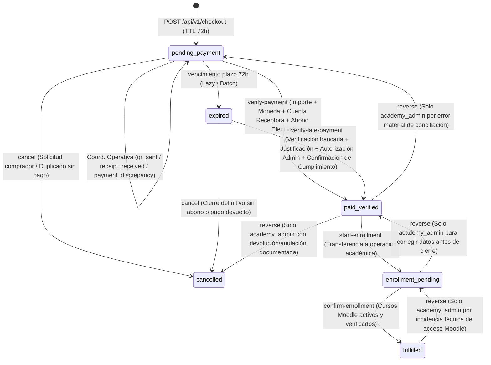
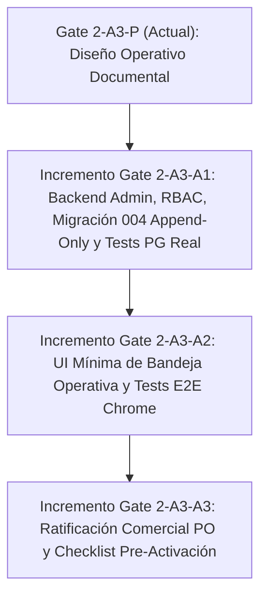

# NOVAFORGE — Gate 2-A3-P: Diseño Operativo de Operación Comercial Asistida

- **Proyecto:** NOVARUM Commerce Engine
- **Cliente MVP:** Dr. Pedro Sevilla — Academia Mujer Sana (`dr-sevilla`)
- **Gate Anterior:** Gate 2-A2 — PASS Definitivo
- **Rama Base Aprobada:** `feature/gate2-a2-checkout-ui` (`7e7da12337811f8e8d7f3ac5008e6d82bdfcce27`)
- **Rama Documental:** `docs/gate2-a3-p-operational-design`
- **Alcance de esta Etapa:** Exclusivamente diseño operativo, modelo de seguridad, máquina de estados y contratos administrativos. **Cero modificaciones a código de aplicación.**

> [!IMPORTANT]
> **Principio Rector de Arquitectura:** Implementar el circuito mínimo, seguro y auditable: **pedido (`pending_payment`) → QR manual → abono bancario verificado (`paid_verified`) → matrícula Moodle (`enrollment_pending` → `fulfilled`)**, sin desarrollar un CRM generalista, sin construir un sistema complejo de administración de usuarios y sin integrar pasarelas bancarias automáticas.

---

## 1. Contrato Funcional de Operación Asistida

### 1.1 Separación de Responsabilidades y Frontera de Confianza
El flujo comercial de la Academia Mujer Sana (`dr-sevilla`) divide la operación en cuatro dominios con fronteras de autoridad estrictas:

```mermaid
flowchart LR
    subgraph Public["1. Dominio Público (Gate 2-A2)"]
        A["Compradora selecciona SKU y envía Checkout"] --> B["Orden creada en pending_payment"]
    end
    subgraph Coord["2. Coordinación Humana de Pago QR"]
        B --> C["Operador genera QR en banca oficial y lo envía manualmente"]
        C --> D["Evento auditable: qr_sent / receipt_received (sigue en pending_payment)"]
    end
    subgraph Bank["3. Conciliación Financiera (Autoridad Bancaria)"]
        D --> E["Verificador comprueba importe, moneda, cuenta receptora y abono efectivo"]
        E --> F["Transición atómica a paid_verified"]
    end
    subgraph Moodle["4. Operación Académica (Moodle)"]
        F --> G["Inicio de alta académica: enrollment_pending"]
        G --> H["Alta manual en Moodle + acceso verificado: fulfilled"]
    end
```



### 1.2 Invariantes Contractuales Obligatorios
1. **Autoridad exclusiva del backend administrativo:** Ningún endpoint público ni acción originada desde el navegador del comprador tiene autoridad para transicionar un pedido hacia `paid_verified`, `enrollment_pending` o `fulfilled`.
2. **El comprobante del comprador NO es pago verificado:** La recepción de una captura o PDF enviado por WhatsApp/correo se registra únicamente como evento informativo (`receipt_received` dentro de `order_events`), manteniendo `orders.status = 'pending_payment'`.
3. **Conciliación bancaria multidimensional (sin asumir referencias infalibles):** Para autorizar `paid_verified`, el operador autorizado debe comprobar en la banca oficial:
   - **Importe exacto** (`verified_amount_minor === orders.total_amount_minor`),
   - **Moneda** (`BOB`),
   - **Cuenta receptora oficial ratificada** (`recipient_account_id` / confirmación explícita de cuenta destino), y
   - **Transacción bancaria efectiva** (abono real acreditado en extracto).
   - La referencia bancaria (`bank_reference`) se utiliza para detectar y bloquear duplicados cuando está disponible, pero el diseño **no asume que siempre estará presente o será inequívoca** (p. ej., transferencias interbancarias QR ACH con glosas truncadas o códigos internos variables). Todo caso sin referencia estándar o con referencia ambigua exige **resolución humana explícita y documentada** antes de conciliar.
4. **Prohibición de matrícula sin pago verificado:** El sistema impide técnica y transaccionalmente iniciar (`enrollment_pending`) o confirmar (`fulfilled`) una matrícula si el pedido no ha pasado previamente por `paid_verified`.
5. **Cierre condicionado a entrega efectiva:** El estado `fulfilled` solo se registra después de que el operador académico ha habilitado el curso (o los 4 cursos del paquete `mujer-informada-4`) en Moodle y verificado que la estudiante dispone de acceso activo.
6. **Aislamiento multi-academia estricto:** Todas las operaciones administrativas resuelven `academy_id = 'dr-sevilla'` desde la configuración/sesión autenticada del servidor y utilizan las claves foráneas compuestas `(academy_id, order_id)` establecidas en PostgreSQL ([001_initial_schema.sql](file:///Users/carlosloayza/.gemini/antigravity/scratch/dr-pedro-sevilla/backend/migrations/001_initial_schema.sql#L75-L119)).
7. **Exclusión de alcance (Anti-Bloat):**
   - No se desarrolla un CRM generalista (sin embudos comerciales, etiquetas libres, historial de chats ni campañas de marketing).
   - No se construye un módulo de administración/ABM de usuarios ni flujos de auto-registro de operadores.
   - No se integran APIs bancarias ni generación automática de códigos QR.
   - No se automatiza el aprovisionamiento vía API hacia Moodle en este gate.

---

## 2. Matriz de Roles, Permisos y Acciones (RBAC Mínimo)

### 2.1 Modelo RBAC Mínimo y Aprovisionamiento Simple
- **Sin sistema complejo de gestión de usuarios:** Los operadores autorizados de `dr-sevilla` se aprovisionan mediante configuración/semilla controlada en el backend (identificador nominal `operator_id`, rol asignado, hash de credencial y estado activo), sin pantallas de CRUD de usuarios, sin gestión de perfiles complejos ni recuperación de contraseñas por correo.
- **Autenticación obligatoria por solicitud:** Todo request a `/api/v1/admin/*` exige sesión administrativa válida (`Authorization: Bearer <token>` o cookie `HttpOnly; Secure; SameSite=Strict` con expiración corta).
- **Trazabilidad nominal obligatoria:** El backend resuelve `operator_id` y `operator_role` exclusivamente desde la sesión verificada en servidor y los graba en cada fila de `order_events`. Nunca se acepta `operator_id` ni `role` enviados libremente en el payload por el cliente.
- **Cero autorizaciones financieras implícitas:** Ninguna acción de coordinación ni de matrícula otorga ni presume permisos financieros. Cada acción verifica explícitamente el rol requerido en el endpoint correspondiente, y ni CORS, ni banderas frontend, ni el conocimiento de `order_number`, `order.id` o `opaque_token` otorgan autorización administrativa.

### 2.2 Definición de los Tres Roles Operativos
1. **`academic_operator` (Operador Académico):** Consulta la bandeja de pedidos, genera/envía manualmente el QR oficial, registra eventos de coordinación (`qr_sent`, `receipt_received`, `payment_discrepancy`) y ejecuta el flujo de matrícula en Moodle (`paid_verified → enrollment_pending → fulfilled`). **Nunca** puede verificar pagos ni autorizar pagos tardíos.
2. **`finance_verifier` (Verificador Bancario):** Consulta la bandeja de pedidos y autoriza la verificación de abonos ordinarios en vigencia (`pending_payment → paid_verified`) tras comprobar importe, moneda, cuenta receptora y transacción efectiva en banco. **No** puede ejecutar matrículas en Moodle ni reactivar por sí solo pedidos expirados sin autorización administrativa.
3. **`academy_admin` (Administrador Titular / Dirección Operativa):** Rol de autoridad administrativa que, además de poder ejecutar verificaciones y matrículas debidamente identificadas con su `operator_id`, es el **único** facultado para:
   - Autorizar la reactivación y conciliación de un **pago tardío** (`expired → paid_verified`) previa verificación bancaria, justificación, autorización administrativa y confirmación de viabilidad de cumplimiento;
   - Resolver casos de **conciliación bancaria ambigua** o sin referencia estándar; y
   - Ejecutar **reversiones auditables** (`reverse`) ante errores materiales, sin borrar evidencia histórica.

### 2.3 Matriz de Permisos por Acción

| Acción Operativa | Endpoint Administrativo | `public` (Comprador) | `academic_operator` | `finance_verifier` | `academy_admin` |
| :--- | :--- | :---: | :---: | :---: | :---: |
| Crear pedido (`pending_payment`) | `POST /api/v1/checkout` | **SÍ** | — | — | — |
| Consultar estado público sin PII | `GET /api/v1/orders/:opaque_token/status` | **SÍ** | — | — | — |
| Listar bandeja de pedidos (con PII autorizada) | `GET /api/v1/admin/orders` | NO (`401`) | **SÍ** | **SÍ** | **SÍ** |
| Consultar detalle e historial `order_events` | `GET /api/v1/admin/orders/:order_id` | NO (`401`) | **SÍ** | **SÍ** | **SÍ** |
| Registrar envío de QR (`qr_sent`) | `POST /api/v1/admin/orders/:order_id/coordination` | NO (`401`) | **SÍ** | **SÍ** | **SÍ** |
| Registrar recepción de comprobante (`receipt_received`) | `POST /api/v1/admin/orders/:order_id/coordination` | NO (`401`) | **SÍ** | **SÍ** | **SÍ** |
| Registrar incidencia/ambigüedad (`payment_discrepancy`) | `POST /api/v1/admin/orders/:order_id/coordination` | NO (`401`) | **SÍ** | **SÍ** | **SÍ** |
| Verificar abono bancario ordinario (`pending_payment → paid_verified`) | `POST /api/v1/admin/orders/:order_id/verify-payment` | NO (`401`) | **NO (`403`)** | **SÍ** | **SÍ** |
| Autorizar y verificar pago tardío (`expired → paid_verified`) | `POST /api/v1/admin/orders/:order_id/verify-late-payment` | NO (`401`) | **NO (`403`)** | **NO (`403`)** | **SÍ** |
| Iniciar trámite Moodle (`paid_verified → enrollment_pending`) | `POST /api/v1/admin/orders/:order_id/start-enrollment` | NO (`401`) | **SÍ** | **NO (`403`)** | **SÍ** |
| Confirmar matrícula Moodle (`enrollment_pending → fulfilled`) | `POST /api/v1/admin/orders/:order_id/confirm-enrollment` | NO (`401`) | **SÍ** | **NO (`403`)** | **SÍ** |
| Cancelar pedido impago (`pending_payment / expired → cancelled`) | `POST /api/v1/admin/orders/:order_id/cancel` | NO (`401`) | **SÍ** | **SÍ** | **SÍ** |
| Revertir estado por error operativo (`reverse`) | `POST /api/v1/admin/orders/:order_id/reverse` | NO (`401`) | **NO (`403`)** | **NO (`403`)** | **SÍ** |

---

## 3. Máquina de Estados y Reglas de Transición

### 3.1 Conservación Estricta de los 6 Estados Contractuales
Se reutilizan **exclusivamente** los 6 valores de `orders.status` ya aprobados en Gate 2-A1 y Gate 2-A2 ([js/checkout.js](file:///Users/carlosloayza/.gemini/antigravity/scratch/dr-pedro-sevilla/js/checkout.js#L67-L74)):
- `pending_payment`
- `paid_verified`
- `enrollment_pending`
- `fulfilled`
- `expired`
- `cancelled`

No se agregan estados nuevos a `orders.status`. Los hitos intermedios de coordinación (`qr_sent`, `receipt_received`, `payment_discrepancy`) se registran en `order_events` manteniendo `previous_status = 'pending_payment'` y `new_status = 'pending_payment'`.

### 3.2 Diagrama de la Máquina de Estados



### 3.3 Tabla de Reglas de Transición y Precondiciones Atómicas

Todas las transiciones ejecutan `SELECT ... FROM orders WHERE academy_id = $1 AND id = $2 FOR UPDATE` dentro de una transacción `BEGIN ... COMMIT` en PostgreSQL:

| ID | Estado Origen (`previous_status`) | Estado Destino (`new_status`) | Acción / Endpoint | Roles Autorizados | Precondiciones Obligatorias y Validaciones |
| :--- | :--- | :--- | :--- | :--- | :--- |
| **T-00** | `NULL` | `pending_payment` | `POST /api/v1/checkout` | Público | Precio oficial desde BD, `expires_at = created_at + 72h`, `idempotency_key` única por academia. |
| **T-01** | `pending_payment` | `pending_payment` | `POST .../coordination` | `academic_operator`, `finance_verifier`, `academy_admin` | Registra `metadata.event_type IN ('qr_sent', 'receipt_received', 'payment_discrepancy')`, `channel`, `notes`, `operator_id`. No altera `orders.status`. |
| **T-02** | `pending_payment` | `paid_verified` | `POST .../verify-payment` | `finance_verifier`, `academy_admin` | 1. `orders.status === 'pending_payment'` y `orders.expires_at >= NOW()` (un pedido vencido es rechazado aquí y debe ir por **T-06**).<br>2. `verified_amount_minor === orders.total_amount_minor` y `verified_currency === 'BOB'`.<br>3. `recipient_account_verified === true` e identificación de `recipient_account_id` oficial.<br>4. `effective_transaction_verified === true` y `bank_credit_at` válido.<br>5. Si existe `bank_reference` estándar: se normaliza y se verifica que no esté duplicada en otro pedido activo de `dr-sevilla`.<br>6. Si la referencia bancaria está ausente o es ambigua (`reconciliation_mode = 'manual_resolution'`): requiere rol `academy_admin` (o resolución humana explícita) documentando en `reconciliation_evidence` (mín. 20 caracteres) los datos observados en el extracto (fecha/hora exacta, titular/glosa y cuenta receptora). |
| **T-03** | `paid_verified` | `enrollment_pending` | `POST .../start-enrollment` | `academic_operator`, `academy_admin` | El pedido debe estar exactamente en `paid_verified`. Registra en `order_events` el inicio de alta académica y los cursos Moodle objetivo según el SKU. |
| **T-04** | `enrollment_pending` | `fulfilled` | `POST .../confirm-enrollment` | `academic_operator`, `academy_admin` | 1. `orders.status === 'enrollment_pending'`.<br>2. `moodle_user_identifier` no vacío.<br>3. `moodle_courses_enrolled` coincide exactamente con los cursos requeridos por el SKU.<br>4. `access_confirmed === true`. |
| **T-05** | `pending_payment` | `expired` | Lazy expiration / Batch | Sistema / Admin | `orders.status === 'pending_payment'` y `NOW() > orders.expires_at`. |
| **T-06** | `expired` | `paid_verified` | `POST .../verify-late-payment` | Exclusivo `academy_admin` | **Procedimiento estricto de pago tardío (nunca por simple bandera):**<br>1. **Verificación bancaria completa:** todas las comprobaciones de importe (`total_amount_minor`), moneda (`BOB`), cuenta receptora oficial y transacción bancaria efectiva de **T-02**.<br>2. **Justificación obligatoria:** `late_payment_reason` detallado ($\ge 15$ caracteres) explicando por qué el abono ingresó fuera de plazo.<br>3. **Autorización administrativa:** ejecutado exclusivamente por un operador autenticado con rol `academy_admin`.<br>4. **Confirmación de viabilidad de cumplimiento:** `fulfillment_feasibility_confirmed === true` certificando que el curso/paquete sigue vigente y puede matricularse en Moodle. |
| **T-07** | `pending_payment` o `expired` | `cancelled` | `POST .../cancel` | `academic_operator`, `finance_verifier`, `academy_admin` | Prohibido si el pedido ya tiene pago verificado. Exige `reason` obligatorio ($\ge 10$ caracteres). |
| **T-08** | `paid_verified`, `enrollment_pending` o `fulfilled` | Estado anterior válido | `POST .../reverse` | Exclusivo `academy_admin` | **Reversión auditable append-only:** Solo permite `paid_verified → pending_payment`, `paid_verified → cancelled`, `enrollment_pending → paid_verified` o `fulfilled → enrollment_pending`. Exige `reason` detallado ($\ge 15$ caracteres) y `corrected_event_id`. Jamás modifica ni borra filas previas de `order_events`. |

---

## 4. Diseño Mínimo de la Bandeja de Pedidos

### 4.1 Principios de Interfaz
- **Cero CRM:** Sin gráficos analíticos, sin embudos de prospección, sin mensajería integrada ni edición libre de datos del comprador.
- **Foco en Cola de Trabajo:** El operador visualiza de inmediato qué pedidos requieren enviar QR, cuáles tienen comprobante pendiente de contrastar en banco, cuáles presentan ambigüedad o pago tardío para resolución humana y cuáles están pagados esperando alta en Moodle.
- **Autorización explícita sin atajos:** Los botones de acción financiera (`Verificar en Banco`, `Resolver Pago Tardío`, `Revertir`) solo se habilitan para los roles autorizados y exigen completar los campos de evidencia bancaria y confirmación.

### 4.2 Maqueta Estructural (Wireframe de la Bandeja Operativa)

```text
+------------------------------------------------------------------------------------------------------------------+
| NOVARUM Commerce · Bandeja Operativa — Dr. Pedro Sevilla (dr-sevilla)   [Operador: op_ana | Rol: academic_op] [Salir] |
+------------------------------------------------------------------------------------------------------------------+
| COLAS: [ (1) Pendientes de Pago (4) ]  [ (2) Por Matricular Moodle (2) ]  [ (3) Cumplidos (18) ]  [ Expirados/Canc ] |
| Filtro coordinación: [ Todos | Sin QR enviado | QR enviado | Comprobante reportado | Incidencia/Ambiguo ]            |
+------------------------------------------------------------------------------------------------------------------+
| PEDIDO / FECHA       | PRODUCTO (SKU)             | IMPORTE    | COMPRADORA (CONTACTO)      | ESTADO / HITO      | ACCIÓN PENDIENTE         |
+----------------------+----------------------------+------------+----------------------------+--------------------+--------------------------+
| DPS-20261105-1014    | Pack Mujer Informada 4     | Bs 199.00  | Valeria Mendoza            | pending_payment    | [ 1. Registrar QR Env. ] |
| Creado: 05/11 10:15  | SKU: mujer-informada-4     | BOB        | valeria@ejemplo.com        | ⚪ Sin QR enviado  | [ Ver Detalle / Eventos] |
| Vence:  08/11 10:15  | (4 Cursos Moodle)          |            | Tel: +59170099887 [Copiar] |                    |                          |
+----------------------+----------------------------+------------+----------------------------+--------------------+--------------------------+
| DPS-20261105-1012    | Curso: Endometriosis       | Bs 79.00   | Mariana Quispe             | pending_payment    | [ 2. Verificar en Banco] |
| Creado: 05/11 09:00  | SKU: endometriosis         | BOB        | mariana@ejemplo.com        | 🟡 Comprobante rep.| (Rol finance / admin)    |
| Vence:  08/11 09:00  | (1 Curso Moodle)           |            | Tel: +59178411223 [Copiar] | QR env: 05/11 09:12| [ Ver Detalle / Eventos] |
+----------------------+----------------------------+------------+----------------------------+--------------------+--------------------------+
| DPS-20261104-1008    | Curso: SOP                 | Bs 79.00   | Carla Alarcón              | paid_verified      | [ 3. Iniciar Matrícula ] |
| Creado: 04/11 16:20  | SKU: sop                   | BOB        | carla@ejemplo.com          | 🟢 Abono Ref:      | [ Ver Detalle / Eventos] |
| Pagado: 04/11 17:05  | (1 Curso Moodle)           |            | Tel: +59171234567 [Copiar] | BNB-8849201        |                          |
+----------------------+----------------------------+------------+----------------------------+--------------------+--------------------------+
```

### 4.3 Panel de Detalle y Formularios de Acción Guiada
Al abrir un pedido (`Ver Detalle` o botón de acción), la vista lateral/modal presenta tres bloques:
1. **Ficha Inmutable del Pedido:** `order_number`, `order_id`, `sku`, título, `total_amount_minor` (`Bs 79.00` / `Bs 199.00 BOB`), `created_at`, `expires_at`, datos del comprador (`name`, `email_normalized`, `phone`) y versión de consentimiento aceptada (`v1.0`).
2. **Formulario Contextual según Estado y Rol:**
   - **En `pending_payment` (Coordinación):** Registro de `QR Bancario Enviado`, `Comprobante Reportado por Compradora` (con advertencia: *"Este registro NO verifica el pago ni habilita matrícula"*) o `Incidencia / Caso Ambiguo` (para escalar a revisión humana).
   - **En `pending_payment` (Conciliación Bancaria Ordinaria — `finance_verifier` / `academy_admin`):**
     - Selector de `Cuenta Receptora Oficial` + casilla *"Confirmo ingreso efectivo en esta cuenta receptora"*.
     - Campo `Importe Acreditado (Bs)` y `Moneda (BOB)`.
     - Campo `Fecha y Hora del Abono en Extracto`.
     - Selector `Modo de Referencia`:
       - *Con referencia bancaria inequívoca:* campo `bank_reference` (con control automático de duplicados).
       - *Sin referencia estándar / Caso ambiguo resuelto manualmente:* exige describir en `reconciliation_evidence` los datos verificados en el extracto (glosa, titular, hora exacta) bajo responsabilidad del operador.
   - **En `expired` (Resolución de Pago Tardío — exclusivo `academy_admin`):**
     - Además de todos los campos de verificación bancaria anteriores, exige:
       1. `Justificación de Pago Tardío` (`late_payment_reason`),
       2. Casilla obligatoria `fulfillment_feasibility_confirmed`: *"Confirmo como Administrador que el pedido puede cumplirse y autorizo reactivar esta orden vencida tras comprobar el abono bancario efectivo"*.
   - **En `paid_verified` / `enrollment_pending` (Matrícula Moodle — `academic_operator` / `academy_admin`):** Lista de cursos Moodle requeridos según el SKU, campo `Identificador / Correo en Moodle`, casillas de confirmación por curso y check `access_confirmed`.
3. **Bitácora de Auditoría (`order_events` — Append-Only):** Tabla cronológica inmutable con `Fecha/Hora`, `Operador (operator_id + rol)`, `Estado Previo → Estado Nuevo`, `Referencia de Conciliación / Modo` y `Motivo / Evidencia`.

---

## 5. Especificación de Endpoints Administrativos y Auditoría

### 5.1 Garantías de Auditoría Inmutable (`order_events`)
La tabla `order_events` ([001_initial_schema.sql](file:///Users/carlosloayza/.gemini/antigravity/scratch/dr-pedro-sevilla/backend/migrations/001_initial_schema.sql#L108-L119)) actúa como libro mayor de auditoría **append-only**:
- **Campos obligatorios en cada evento:**
  - `id` (`UUID`): Identificador único del evento.
  - `academy_id` (`VARCHAR(64)`): `'dr-sevilla'`.
  - `order_id` (`UUID`): Pedido afectado.
  - `previous_status` (`VARCHAR(32)`): Estado previo exacto de `orders.status`.
  - `new_status` (`VARCHAR(32)`): Nuevo estado de `orders.status`.
  - `operator_id` (`VARCHAR(64) NOT NULL` en acciones humanas): Identificador del operador autenticado que ejecutó la acción.
  - `reason` (`TEXT`): Motivo o justificación operativa.
  - `metadata` (`JSONB`): Estructura normalizada con:
    - `idempotency_key` (`UUID`),
    - `operator_role` (`academic_operator` | `finance_verifier` | `academy_admin`),
    - `action_type` (`qr_sent`, `receipt_received`, `payment_discrepancy`, `verify_payment`, `verify_late_payment`, `start_enrollment`, `confirm_enrollment`, `cancel`, `reverse`),
    - Datos de conciliación cuando aplique (`bank_reference`, `reconciliation_mode`, `reconciliation_evidence`, `recipient_account_id`, `verified_amount_minor`, `verified_currency`, `bank_credit_at`, `fulfillment_feasibility_confirmed`),
    - Datos de reversión cuando aplique (`corrected_event_id`, `previous_bank_reference`).
  - `created_at` (`TIMESTAMPTZ`): Marca temporal del servidor.
- **Protección contra borrado o alteración histórica:**
  - En la migración incremental `004_admin_operations_and_reconciliation.sql` se incorporará un trigger en PostgreSQL (`BEFORE UPDATE OR DELETE ON order_events`) que lance excepción inmediata (`ORDER_EVENTS_IMMUTABLE`), garantizando a nivel de motor de base de datos que ninguna fila histórica de auditoría pueda ser editada ni eliminada jamás.
- **Detección de duplicados de referencia bancaria sin asumir disponibilidad universal:**
  - Columna nullable `bank_reference VARCHAR(64)` en `orders` con índice único parcial:
    ```sql
    CREATE UNIQUE INDEX IF NOT EXISTS uq_orders_academy_bank_ref
    ON orders (academy_id, bank_reference)
    WHERE bank_reference IS NOT NULL
      AND status IN ('paid_verified', 'enrollment_pending', 'fulfilled');
    ```
  - Si el extracto bancario provee una referencia (`bank_reference`), PostgreSQL impide atómicamente reutilizarla en otro pedido. Si la transferencia carece de referencia estándar (`bank_reference = NULL`, `reconciliation_mode = 'manual_resolution'`), se exige evidencia descriptiva completa y autorización humana explícita registrada en `order_events`.

### 5.2 Contratos de Endpoints Administrativos (`/api/v1/admin/*`)

#### 1. `GET /api/v1/admin/orders` y `GET /api/v1/admin/orders/:order_id`
- **Roles permitidos:** `academic_operator`, `finance_verifier`, `academy_admin`.
- Filtran estrictamente por `academy_id = 'dr-sevilla'` y devuelven el estado del pedido, hito de coordinación, datos de contacto académico del comprador y la lista completa de `order_events` inmutables.

#### 2. `POST /api/v1/admin/orders/:order_id/coordination`
- **Roles permitidos:** `academic_operator`, `finance_verifier`, `academy_admin`.
- **Estado requerido:** `pending_payment`.
- **Body:**
  ```json
  {
    "event_type": "qr_sent",
    "channel": "whatsapp_academic",
    "external_reference": "WA-78456338-20261105",
    "notes": "QR bancario manual enviado por Bs 199.00 con glosa DPS-20261105-1014",
    "idempotency_key": "9b1deb4d-3b7d-4bad-9bdd-2b0d7b3dcb6d"
  }
  ```
  *(Valores válidos de `event_type`: `'qr_sent'`, `'receipt_received'`, `'payment_discrepancy'`)*.

#### 3. `POST /api/v1/admin/orders/:order_id/verify-payment` (Pedido en vigencia: `pending_payment → paid_verified`)
- **Roles permitidos:** `finance_verifier`, `academy_admin` (`academic_operator` recibe `403 Forbidden`).
- **Estado requerido:** `orders.status === 'pending_payment'` y `orders.expires_at >= NOW()` (si el pedido está en `expired` o vencido, este endpoint rechaza con `409 ORDER_EXPIRED_REQUIRES_LATE_PAYMENT_AUTH`).
- **Body:**
  ```json
  {
    "reconciliation_mode": "standard_reference",
    "bank_reference": "BNB-20261105-998877",
    "reconciliation_evidence": "Abono QR verificado en extracto cuenta oficial con glosa DPS-20261105-1014",
    "recipient_account_id": "CTA-OFICIAL-DR-SEVILLA-BOB",
    "recipient_account_verified": true,
    "effective_transaction_verified": true,
    "verified_amount_minor": 19900,
    "verified_currency": "BOB",
    "bank_credit_at": "2026-11-05T18:30:00.000Z",
    "reason": "Abono verificado en extracto bancario oficial por importe, moneda y cuenta receptora",
    "idempotency_key": "1b9d6bcd-bbfd-4b2d-9b5d-ab8dfbbd4bed"
  }
  ```
- **Reglas de validación:**
  - `422 AMOUNT_OR_CURRENCY_MISMATCH` si `verified_amount_minor !== orders.total_amount_minor` o `verified_currency !== 'BOB'`.
  - `422 RECIPIENT_OR_TRANSACTION_UNVERIFIED` si `recipient_account_verified !== true`, `!recipient_account_id` o `effective_transaction_verified !== true`.
  - Si `reconciliation_mode === 'standard_reference'`: exige `bank_reference` no vacío (6–64 chars) y comprueba unicidad en `(academy_id, bank_reference)` (`409 DUPLICATE_BANK_REFERENCE` en caso de colisión).
  - Si `reconciliation_mode === 'manual_resolution'` (cuando el banco no provee referencia inequívoca): exige rol `academy_admin` (o resolución supervisada) y `reconciliation_evidence` detallado ($\ge 20$ caracteres) describiendo titular, fecha/hora exacta y glosa del extracto.

#### 4. `POST /api/v1/admin/orders/:order_id/verify-late-payment` (Pago tardío sobre pedido expirado: `expired → paid_verified`)
- **Rol permitido:** Exclusivamente `academy_admin` (`academic_operator` y `finance_verifier` reciben `403 Forbidden`).
- **Estado requerido:** `orders.status === 'expired'` (o `pending_payment` con `expires_at < NOW()`, registrando primero el vencimiento y luego la reactivación autorizada).
- **Body:**
  ```json
  {
    "reconciliation_mode": "standard_reference",
    "bank_reference": "BNB-20261109-445566",
    "reconciliation_evidence": "Abono QR recibido fuera de ventana de 72h pero acreditado íntegramente en cuenta oficial",
    "recipient_account_id": "CTA-OFICIAL-DR-SEVILLA-BOB",
    "recipient_account_verified": true,
    "effective_transaction_verified": true,
    "verified_amount_minor": 7900,
    "verified_currency": "BOB",
    "bank_credit_at": "2026-11-09T11:20:00.000Z",
    "late_payment_reason": "Compradora transfirió al cuarto día sobre el QR enviado; abono efectivo comprobado en extracto",
    "fulfillment_feasibility_confirmed": true,
    "idempotency_key": "4a8f6bcd-bbfd-4b2d-9b5d-ab8dfbbd9911"
  }
  ```
- **Reglas estrictas:**
  1. Ejecuta el 100% de las validaciones bancarias de `verify-payment` (importe, moneda, cuenta receptora, transacción efectiva y control de duplicidad de referencia).
  2. Exige `late_payment_reason` ($\ge 15$ caracteres).
  3. Exige rol `academy_admin` autenticado en sesión.
  4. Exige `fulfillment_feasibility_confirmed === true` (`422 FULFILLMENT_FEASIBILITY_REQUIRED` si falta o es `false`).

#### 5. `POST /api/v1/admin/orders/:order_id/start-enrollment` y `POST /api/v1/admin/orders/:order_id/confirm-enrollment`
- **Roles permitidos:** `academic_operator`, `academy_admin` (`finance_verifier` recibe `403 Forbidden`).
- `start-enrollment`: Exige `orders.status === 'paid_verified'` y transiciona a `enrollment_pending`.
- `confirm-enrollment`: Exige `orders.status === 'enrollment_pending'`, `moodle_user_identifier`, `moodle_courses_enrolled` idéntico al mapa del SKU, `access_confirmed === true` y `reason`, transicionando a `fulfilled`.

#### 6. `POST /api/v1/admin/orders/:order_id/cancel` y `POST /api/v1/admin/orders/:order_id/reverse`
- `cancel`: Permite cancelar pedidos en `pending_payment` o `expired` con `reason` obligatorio ($\ge 10$ caracteres).
- `reverse`: Exclusivo `academy_admin`. Registra un nuevo evento en `order_events` con `corrected_event_id`, `previous_status`, `new_status`, `operator_id` y `reason` ($\ge 15$ caracteres), restaurando el estado anterior sin alterar ni eliminar ningún evento previo.

---

## 6. Procedimiento Operativo de Conciliación QR y Matrícula Moodle

### 6.1 Mapa Oficial de Correspondencia SKU → Cursos Moodle (`dr-sevilla`)

| SKU Comercial | Título en Catálogo | Importe Oficial | Cursos Moodle a Habilitar (Vigencia 180 días) |
| :--- | :--- | :---: | :--- |
| `endometriosis` | Curso: Endometriosis | `Bs 79.00` (`7900`) | `["endometriosis"]` (1 curso) |
| `vaginosis` | Curso: Vaginosis Bacteriana | `Bs 79.00` (`7900`) | `["vaginosis"]` (1 curso) |
| `sop` | Curso: Síndrome de Ovario Poliquístico (SOP) | `Bs 79.00` (`7900`) | `["sop"]` (1 curso) |
| `aprende-mujer` | Curso: Aprende Mujer — Ecosistema Vaginal | `Bs 79.00` (`7900`) | `["aprende-mujer"]` (1 curso) |
| `mujer-informada-4` | Pack Completo: Mujer Informada (4 Cursos) | `Bs 199.00` (`19900`) | `["endometriosis", "vaginosis", "sop", "aprende-mujer"]` (4 cursos) |

### 6.2 Protocolo Operativo Estándar (SOP)

1. **Coordinación y Envío Manual del QR (`academic_operator`):**
   - Filtra pedidos en `pending_payment` sin QR enviado.
   - Genera manualmente el QR en la banca oficial de la cuenta receptora por el importe exacto (`Bs 79.00` o `Bs 199.00` BOB) incluyendo el `order_number` (`DPS-YYYYMMDD-XXXX`) en la glosa.
   - Envía el QR a la compradora por el canal académico oficial y registra `qr_sent`.
   - Si recibe captura de pago, registra `receipt_received` (el pedido continúa en `pending_payment`).

2. **Verificación Bancaria Multidimensional (`finance_verifier` / `academy_admin`):**
   - Contrasta en el extracto bancario oficial los cuatro elementos obligatorios: **cuenta receptora**, **transacción efectiva acreditada**, **moneda (`BOB`)** e **importe exacto** (`Bs 79.00` o `Bs 199.00`).
   - Si el extracto muestra una referencia bancaria inequívoca (`bank_reference`), la ingresa en modo `standard_reference` (el sistema bloquea duplicados automáticamente).
   - Si el extracto no ofrece una referencia inequívoca o presenta ambigüedad (glosa truncada, transferencia ACH sin código visible o dos compradoras del mismo monto en minutos cercanos), el verificador registra `payment_discrepancy` y escala a **resolución humana** (`academy_admin`), quien contrasta comprobantes/titulares/horarios y documenta la evidencia completa antes de autorizar `paid_verified`.

3. **Resolución de Pagos Tardíos sobre Pedidos Expirados (`academy_admin`):**
   - Cuando un abono ingresa después de las 72 horas (`status = 'expired'`), no basta marcar un check: el `academy_admin` debe comprobar el abono bancario efectivo en la cuenta receptora, verificar que el curso/paquete puede cumplirse en Moodle (`fulfillment_feasibility_confirmed = true`), redactar la justificación (`late_payment_reason`) y ejecutar `verify-late-payment`.

4. **Matriculación en Moodle y Cierre (`academic_operator`):**
   - Toma el pedido en `paid_verified`, inicia `start-enrollment` (`enrollment_pending`), habilita el curso o los 4 cursos en Moodle, comprueba que el acceso de la estudiante funciona y ejecuta `confirm-enrollment` (`fulfilled`).

---

## 7. Riesgos y Criterios de Aceptación PASS/FAIL

### 7.1 Matriz de Riesgos y Controles

| Riesgo Identificado | Impacto | Control de Mitigación en Diseño |
| :--- | :---: | :--- |
| **R-01: Comprobante falso o editado enviado por WhatsApp** | Alto | `receipt_received` no cambia `orders.status`; `paid_verified` exige comprobar cuenta receptora, importe, moneda y abono efectivo en extracto bancario. |
| **R-02: Reutilización de un mismo abono bancario o referencia ambigua** | Alto | Índice único parcial `(academy_id, bank_reference)` cuando hay referencia estándar, y escalamiento obligatorio a resolución humana (`academy_admin`) con evidencia detallada cuando la referencia es ausente o ambigua. |
| **R-03: Reactivación indebida de pedidos expirados** | Alto | Prohibido reactivar `expired → paid_verified` con una simple bandera; requiere endpoint separado exclusivo de `academy_admin`, verificación bancaria completa, justificación escrita y confirmación explícita de que el pedido puede cumplirse. |
| **R-04: Alta en Moodle sin pago verificado o cursos incompletos** | Alto | `start-enrollment` exige `paid_verified`; `confirm-enrollment` exige `enrollment_pending` y valida `moodle_courses_enrolled` contra el mapa oficial del SKU. |
| **R-05: Alteración o borrado de evidencia histórica de auditoría** | Alto | Trigger `BEFORE UPDATE OR DELETE ON order_events` en PostgreSQL que hace la bitácora estrictamente append-only; toda corrección se registra como un nuevo evento `reverse` con `operator_id`, `corrected_event_id` y `reason`. |
| **R-06: Autorizaciones financieras implícitas o sobre-ingeniería de usuarios** | Medio | RBAC mínimo de 3 roles aprovisionados en servidor, verificación explícita de rol por endpoint y registro de `operator_id` en cada acción sin construir un sistema complejo de gestión de usuarios. |

### 7.2 Criterios de Aceptación PASS/FAIL (Para Auditoría de Implementación en Gate 2-A3)

1. **Autenticación, RBAC Mínimo y Cero Autorización Implícita (PASS/FAIL):**
   - `PASS` si todos los endpoints `/api/v1/admin/*` exigen sesión válida (`401` sin sesión), registran `operator_id` real desde sesión, bloquean a `academic_operator` en verificaciones bancarias (`403`) y bloquean a `finance_verifier` en matrículas Moodle, pagos tardíos y reversiones (`403`).
2. **Conciliación Bancaria Completa y Manejo de Casos Ambiguos (PASS/FAIL):**
   - `PASS` si `verify-payment` valida importe, moneda (`BOB`), cuenta receptora y transacción efectiva; rechaza con `409` cualquier `bank_reference` duplicada en `dr-sevilla`; y exige resolución humana documentada cuando no existe referencia inequívoca.
3. **Control Estricto de Pago Tardío `expired → paid_verified` (PASS/FAIL):**
   - `PASS` si `verify-payment` ordinario rechaza pedidos expirados (`409`) y si `verify-late-payment` exige simultáneamente rol `academy_admin`, verificación bancaria completa, `late_payment_reason` y `fulfillment_feasibility_confirmed === true`.
4. **Inmutabilidad Append-Only de `order_events` y Reversiones Trazables (PASS/FAIL):**
   - `PASS` si PostgreSQL rechaza cualquier `UPDATE` o `DELETE` sobre `order_events`, si cada evento conserva `operator_id`, fecha, `previous_status`, `new_status`, `reason` y referencia de conciliación, y si las reversiones agregan nuevos eventos sin borrar historial.
5. **No Regresión de Gate 1, Gate 2-A1 y Gate 2-A2 (PASS/FAIL):**
   - `PASS` si las 39 pruebas existentes continúan pasando al 100% en Linux CI junto con las nuevas pruebas unitarias, E2E y de PostgreSQL real.

---

## 8. Plan de Implementación Dividido en Incrementos Pequeños



1. **Incremento `Gate 2-A3-A1` — Backend Administrativo, RBAC Mínimo y Auditoría Append-Only:**
   - Migración incremental `004_admin_operations_and_reconciliation.sql` (trigger de inmutabilidad en `order_events`, columna e índice único parcial `bank_reference` en `orders`, e índices operativos).
   - Autenticación de operador y RBAC mínimo (`academic_operator`, `finance_verifier`, `academy_admin`) + servicio transaccional `OrderOperationsService` para coordinación, verificación bancaria, pago tardío, matrícula Moodle, cancelación y reversión.
   - Pruebas unitarias (`pg-mem`), pruebas de concurrencia e inmutabilidad en PostgreSQL 16 real y sanitización de logs.
2. **Incremento `Gate 2-A3-A2` — Bandeja Operativa Mínima (UI) y Pruebas E2E en Navegador Real:**
   - Interfaz administrativa mínima en HTML/CSS/JS vanilla para operar las colas (`pending_payment`, `paid_verified`, `enrollment_pending`, `fulfilled`, `expired`/`cancelled`) y visualizar la bitácora `order_events`.
   - Suite E2E en Headless Chrome (CDP) validando el circuito completo: pedido → QR manual → abono verificado → matrícula Moodle.
3. **Incremento `Gate 2-A3-A3` — Ratificación Pre-Activación Comercial:**
   - Ratificación con el Product Owner de la cuenta bancaria receptora oficial, canal de WhatsApp académico y operadores designados antes de habilitar cobros reales.

---

**PARADA OBLIGATORIA — DOCUMENTO DE DISEÑO PUBLICADO PARA REVISIÓN EN PR (GATE 2-A3-P)**
